# Screen build log

## Setup - JavaFX

- What was done: JavaFX 24 SDK (needs Java 22 or later) added to the project, test window opened with JavaFXTest
- Problems and fixes:
  - "JavaFX runtime components are missing": the run configuration needed the VM arguments (--module-path and --add-modules)
  - "Module javafx.controls not found": the module path was missing the colon after C, and the MySQL driver jar sat under Modulepath, which added a second module path. Fixed by moving the driver to the Classpath
  - How it was found: Process Properties > Command Line, then --list-modules outside Eclipse

## Vehicles screen

### Step 1 - Header bar
- Commit message: Vehicles screen step 1: reusable Theme and HeaderBar
- What changed: navy header bar built from the reusable Theme and HeaderBar components
- Test cases touched: none
- Screenshot: 
- Problems and fixes: none

### Step 2 - Vehicle table
- Commit message: Vehicles screen step 2: vehicle table (reusable TableColumns and Dialogs)
- What changed: table of vehicles loaded through VehicleDAO.findAll, built with the reusable TableColumns helper; errors go through the reusable Dialogs class
- Test cases touched: none
- Screenshot: 
- Problems and fixes: a leftover Test Vehicle row from the DAO test showed 11 rows instead of 10, fixed by re-running sample_data.sql; the header bar background was missing, fixed

### Step 3 - Status and type filters
- Commit message: Vehicles screen step 3: status and type filters (reusable AllChoiceBox)
- What changed: two dropdown filters built with the reusable AllChoiceBox; the table reloads through VehicleDAO.findAll(status, type); a count shows below the table
- Test cases touched: TC-07, TC-08
- Screenshots: 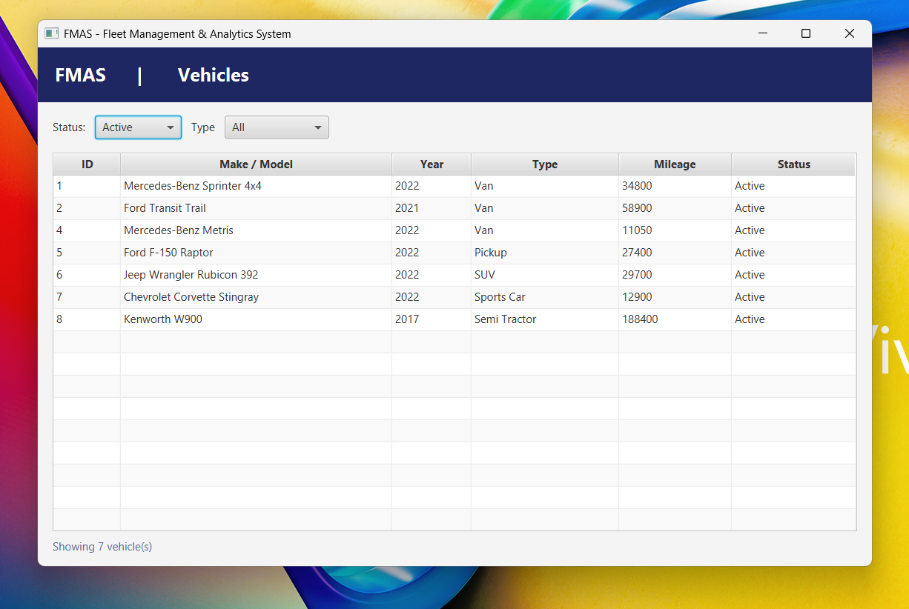 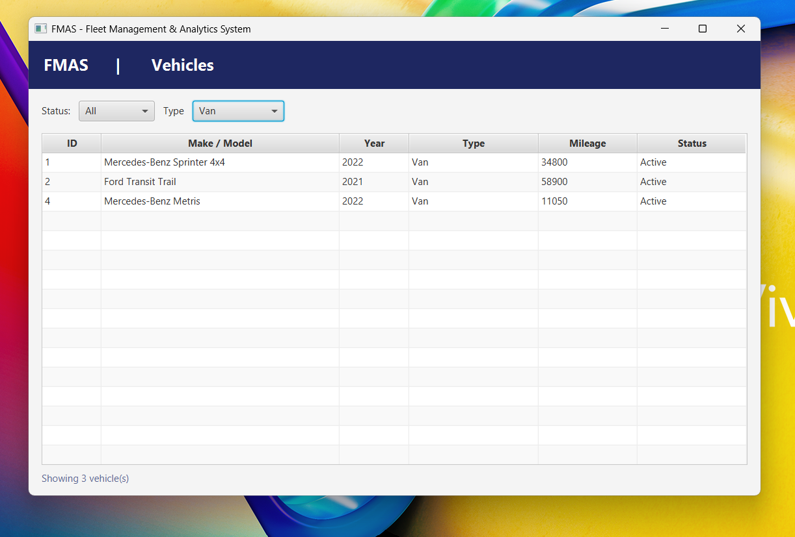
- Problems and fixes: none

### Step 4 - Shell, sidebar and tabs
- Commit message: Vehicles screen step 4: shell with sidebar, tabs and stylesheet (reusable AppShell, Sidebar, TabSwitch)
- What changed: centered navy header, sidebar with navigation and Logout, Vehicles/Drivers tabs, look moved into fmas.css; the header moved out of VehicleScreen into the shared AppShell
- Test cases touched: none
- Screenshots: 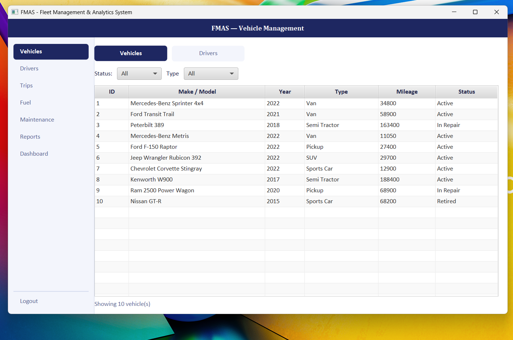 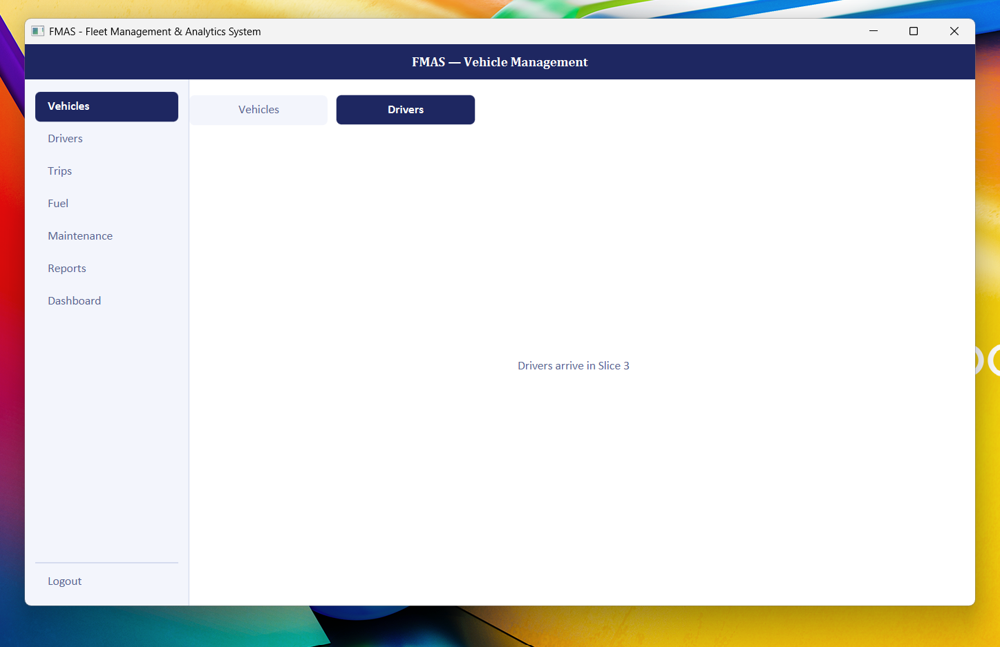
- Problems and fixed: the first run still showed the step 3 layout because MainApp opened VehicleScreen directly instead of through AppShell; the sidebar highlight first did not show, then showed on every item, fixed by making the CSS rule require both class names

### Step 5 - Filter row and styled table
- Commit message: Vehicles screen step 5: search, status and type filters, styled table (reusable LabeledField, PrimaryButton)
- What changed: SEARCH box (narrows loaded rows), STATUS and TYPE dropdowns, + Add Vehicle button, navy table header with alternating rows, IDs shown as V-001, mileage with thousands separators
- Test cases touched: TC-07, TC-08 (re-checked)
- Screenshots: 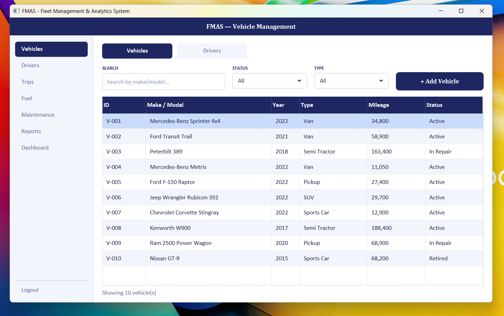 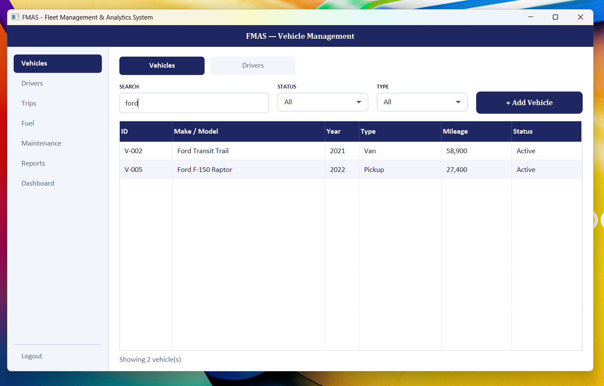
- Problems and fixes: nonethe search box did nothing because loadVehicles() still replaced the table's rows with a new list, bypassing the filtered list; fixed by loading into loadedVehicles and re-applying the search. The count text was missing a space.

### Step 6 - Add Vehicle dialog
- Commit message: Vehicles screen step 6: Add Vehicle dialog with validation (reusable MessageBar, VehicleTypes)
- What changed: + Add Vehicle opens a dialog (make/model, year, type dropdown, mileage, status dropdown); each field is checked with Validator and shows a red message when wrong; a saved vehicle appears selected in the table with a green confirmation
- Test cases touched: TC-01, TC-02
- Screenshots: 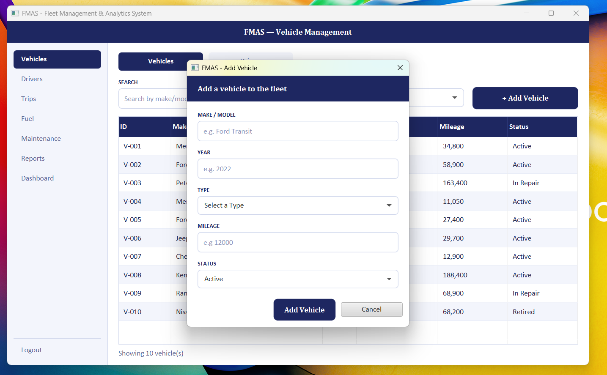 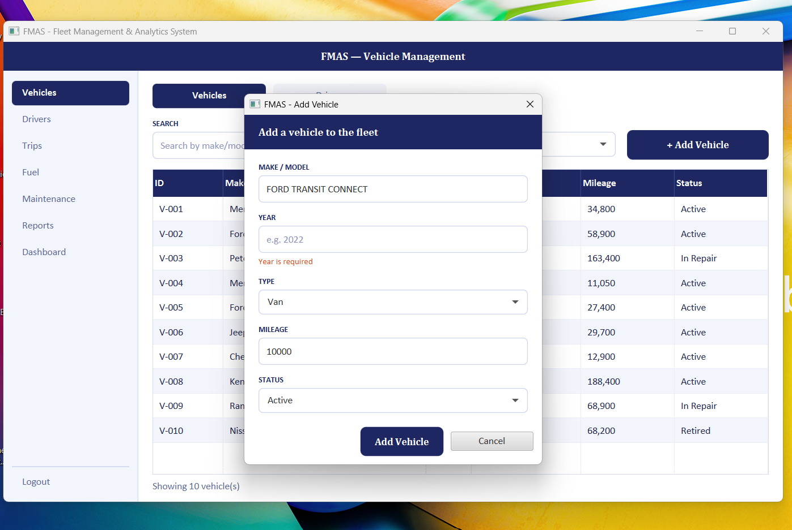 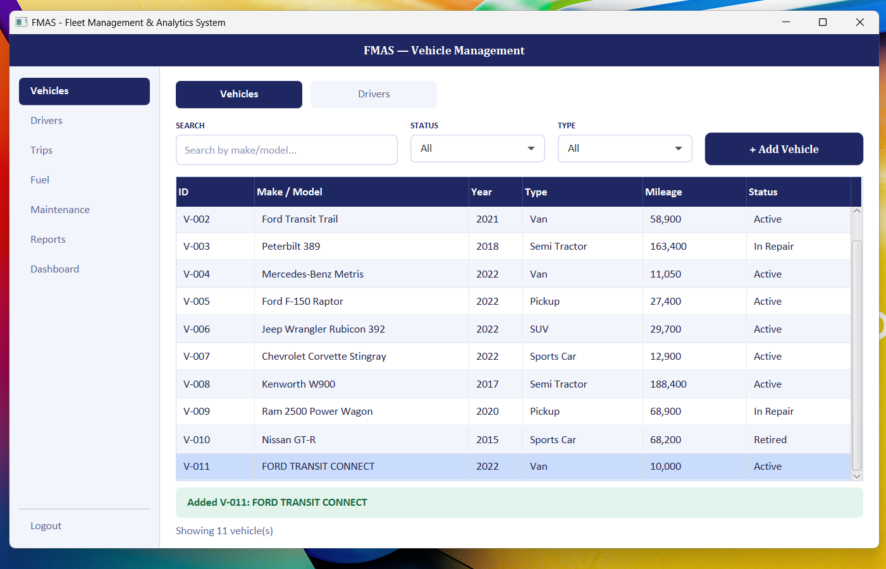
- Problems and fixes: none

### Step 7 - Update vehicle (double-click a row)
- Commit message: Vehicles screen step 7: update mileage and status by double-click (UpdateVehicleDialog, reusable FormDialog)
- What changed: the dialog shell (header, buttons, stylesheet, check before closing) moved into the reusable FormDialog; double-clicking a vehicle opens UpdateVehicleDialog to change mileage and status; mileage cannot go down (Validator.validMileage), status is chosen from a dropdown; changes are saved through VehicleDAO and the table refreshes
- Test cases touched: TC-03, TC-04, TC-05, TC-06 (TC-01 and TC-02 re-checked after the refactor)
- Screenshots: 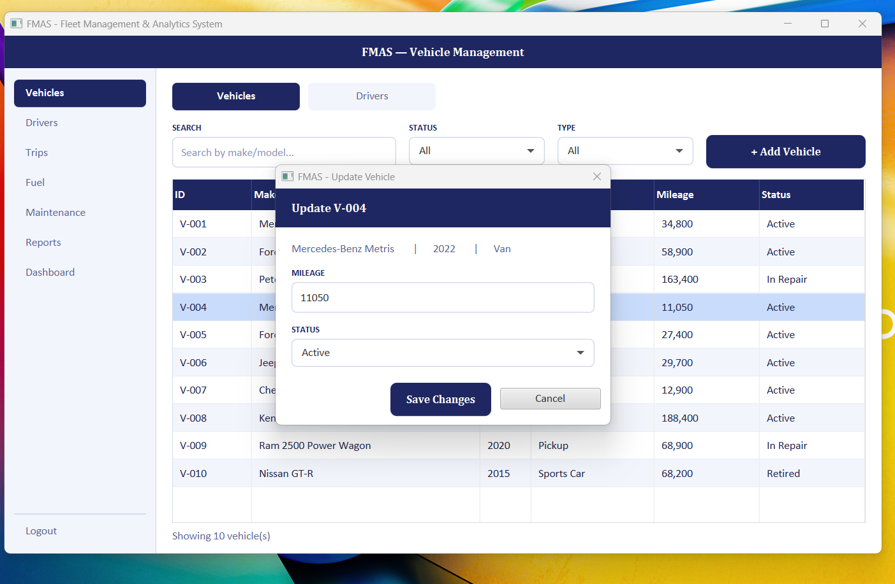 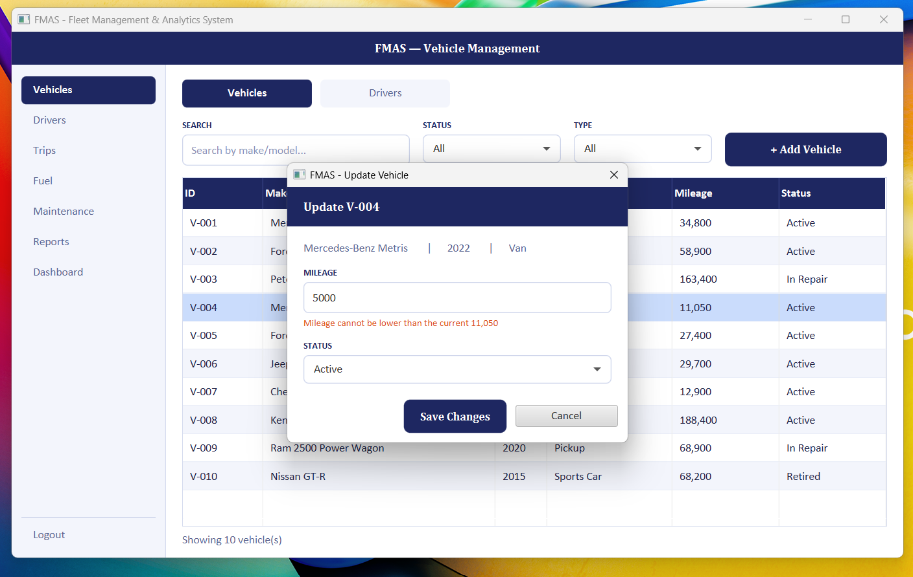 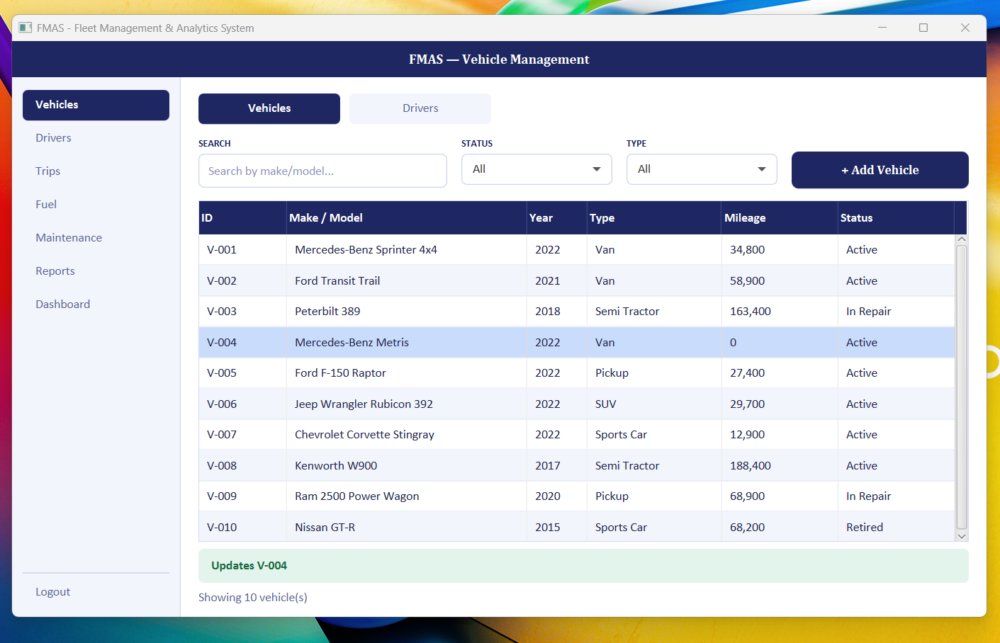
- Problems and fixes: mileage typed with a thousands separator (11,500) was rejected; both dialogs now ignore commas before reading the number

### Fix - Update dialog zeroed the mileage
- Commit message: Fix: update dialog saved mileage as 0 (newMileage was never set)
- What changed: validate() never stored the accepted mileage, so the field kept its default of 0 and every save wrote 0; it now stores the value, and the fields start from the vehicle's current values; the confirmation reads "Updated"
- Test cases touched: TC-03 and TC-05 (found while testing by hand)
- Problems and fixes: a number field that is never assigned silently stays 0, so a forgotten line caused no error

### Step 8 - Slice 1 test run
- Commit message: Slice 1 complete: TC-01 to TC-08 run and logged
- What changed: no code; all eight vehicle test cases run on sample data and passed; results written in Test_Tracking.xlsx; evidence screenshots saved in docs/evidence
- Test cases touched: TC-01 to TC-08
- Problems and fixes: none during the run (the mileage bug found earlier, TC-05, was fixed before this run)

TC-01: Vehicle saved as V-011 and shown in the list; green confirmation displayed 
TC-02: Red message “Year is required” shown; dialog stayed open; list still 11 rows
TC-03: V-004 mileage changed from 11,050 to 11,500, saved and shown in the list
TC-04: Entered 5,000 for V-004; red message “Mileage cannot be lower than the current 11,500”; table unchanged
TC-05: V-004 status changed to In Repair and mileage stayed 11,500
TC-06: Not possible by design: the Status dropdown offers only Active, In Repair and Retired, and nothing can be typed
TC-07: Only Active vehicles shown (7 of 10)
TC-08: Only Van-type vehicles shown (3)

## Login and logout (slice 2)

### Step 1 - Login back end
- Commit message: Slice 2 step 1: User, UserDAO, PasswordHasher and Authenticator (TC-27, TC-28 in the console)
- What changed: passwords are stored as salted PBKDF2 hashes (PasswordHasher); Authenticator answers whether a username and password are valid; UserDAO finds a user by username; CreateUserTool saves the first account; username is unique; no sessions yet, on the professor's advice
- Test cases touched: TC-27, TC-28 (checked in the console; the formal run is at step 4)
- Screenshot: none (the console shows the typed password)
- Problems and fixes: "pbkfd2" was misspelled inside a quoted string in verify(), which made every login fail

### Step 2 - Login card
- Commit message: Slice 2 step 2: login screen (LoginScreen) and the app starts at login
- What changed: centered login card with username, password and a LOG IN button; a failed login shows one red message; a good login opens the app; Logout in the sidebar returns to a fresh login screen
- Test cases touched: TC-27, TC-28 (checked on screen; the formal run is at step 4)
- Screenshots: 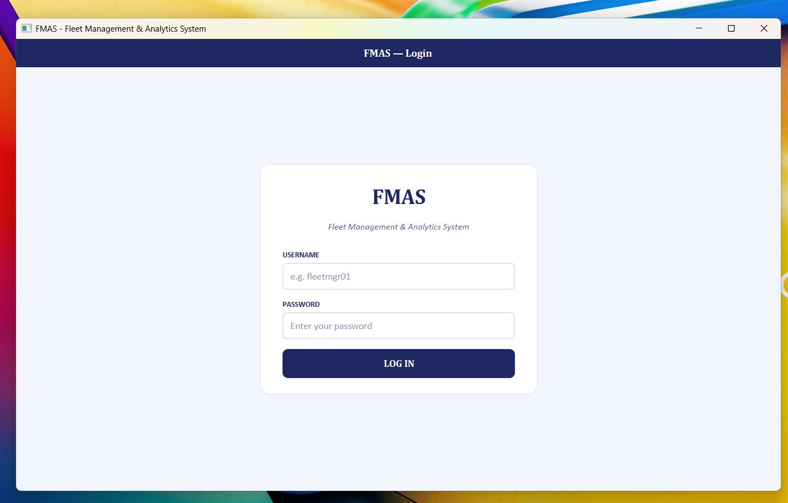 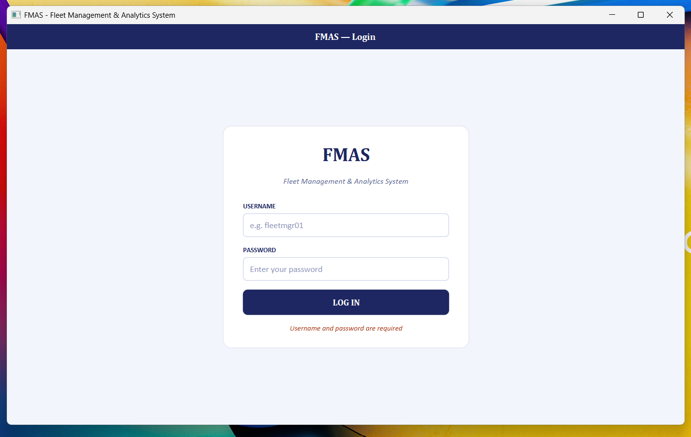
- Problems and fixes: none

### Step 3 - Main Menu shell and navigation
- Commit message: Slice 2 step 3: Main Menu shell, navigation and logout (MainMenuScreen)
- What changed: after login the Main Menu opens (welcome line, three placeholder stat cards, quick actions); Main Menu is now the first sidebar item, so every screen can return to it; Logout returns to a fresh login screen
- Test cases touched: TC-27, TC-29 (checked on screen; the formal run is at step 4)
- Screenshot: 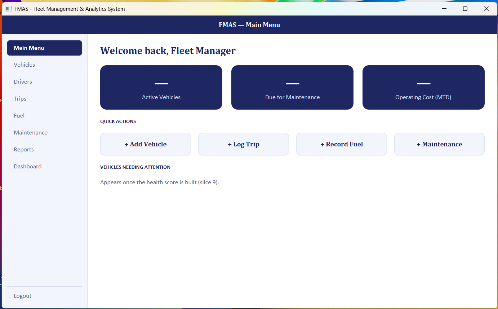
- Problems and fixes: none

