# Screen build log

## Setup - JavaFX

- What was done: JavaFX 24 SDK (needs Java 22 or later) added to the project, test window opened with JavaFXTest
- Problems and fixes:
  - "JavaFX runtime components are missing": the run configuration needed the VM arguments (--module-path and --add-modules)
  - "Module javafx.controls not found": the module path was missing the colon after C, and the MySQL driver jar sat under Modulepath, which added a second module path. Fixed by moving the driver to the Classpath
  - How it was found: Process Properties > Command Line, then --list-modules outside Eclipse

## Vehicles screen

### Step 1 - Header bar
- Commit message: Vehicles screen step 1: reusable Theme and HeaderBar
- What changed: navy header bar built from the reusable Theme and HeaderBar components
- Test cases touched: none
- Screenshot: 
- Problems and fixes: none

### Step 2 - Vehicle table
- Commit message: Vehicles screen step 2: vehicle table (reusable TableColumns and Dialogs)
- What changed: table of vehicles loaded through VehicleDAO.findAll, built with the reusable TableColumns helper; errors go through the reusable Dialogs class
- Test cases touched: none
- Screenshot: 
- Problems and fixes: a leftover Test Vehicle row from the DAO test showed 11 rows instead of 10, fixed by re-running sample_data.sql; the header bar background was missing, fixed

### Step 3 - Status and type filters
- Commit message: Vehicles screen step 3: status and type filters (reusable AllChoiceBox)
- What changed: two dropdown filters built with the reusable AllChoiceBox; the table reloads through VehicleDAO.findAll(status, type); a count shows below the table
- Test cases touched: TC-07, TC-08
- Screenshots: 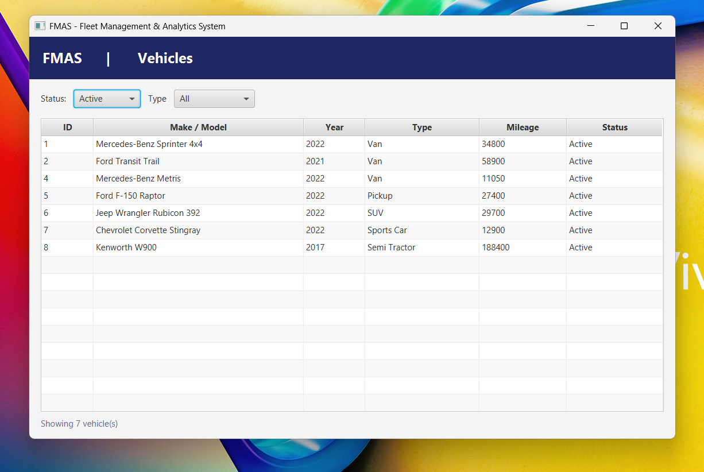 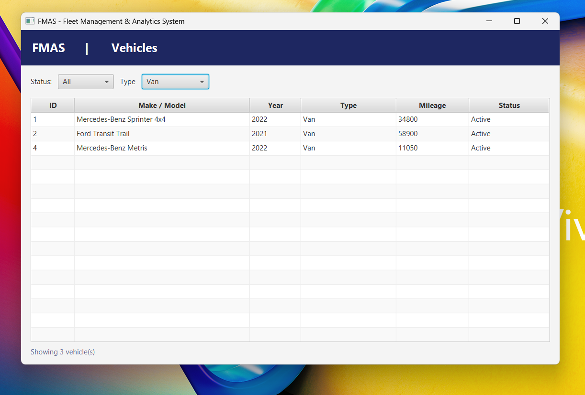
- Problems and fixes: none

### Step 4 - Shell, sidebar and tabs
- Commit message: Vehicles screen step 4: shell with sidebar, tabs and stylesheet (reusable AppShell, Sidebar, TabSwitch)
- What changed: centered navy header, sidebar with navigation and Logout, Vehicles/Drivers tabs, look moved into fmas.css; the header moved out of VehicleScreen into the shared AppShell
- Test cases touched: none
- Screenshots: 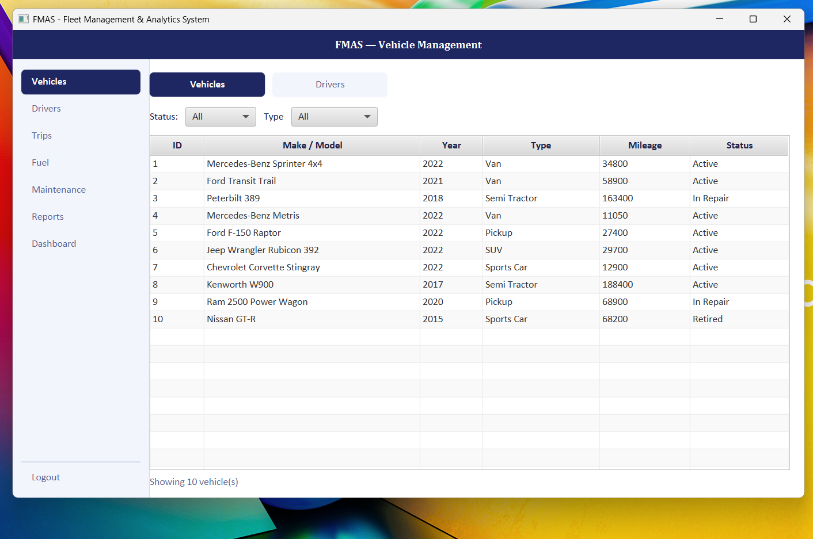 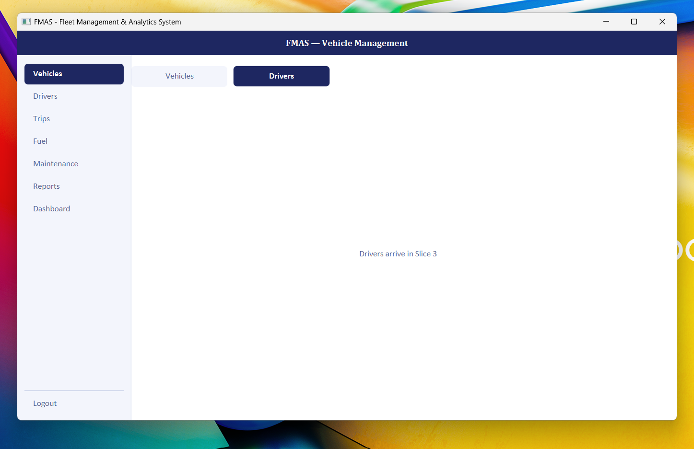
- Problems and fixed: the first run still showed the step 3 layout because MainApp opened VehicleScreen directly instead of through AppShell; the sidebar highlight first did not show, then showed on every item, fixed by making the CSS rule require both class names

### Step 5 - Filter row and styled table
- Commit message: Vehicles screen step 5: search, status and type filters, styled table (reusable LabeledField, PrimaryButton)
- What changed: SEARCH box (narrows loaded rows), STATUS and TYPE dropdowns, + Add Vehicle button, navy table header with alternating rows, IDs shown as V-001, mileage with thousands separators
- Test cases touched: TC-07, TC-08 (re-checked)
- Screenshots: 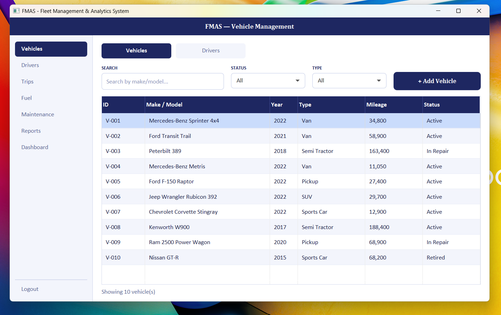 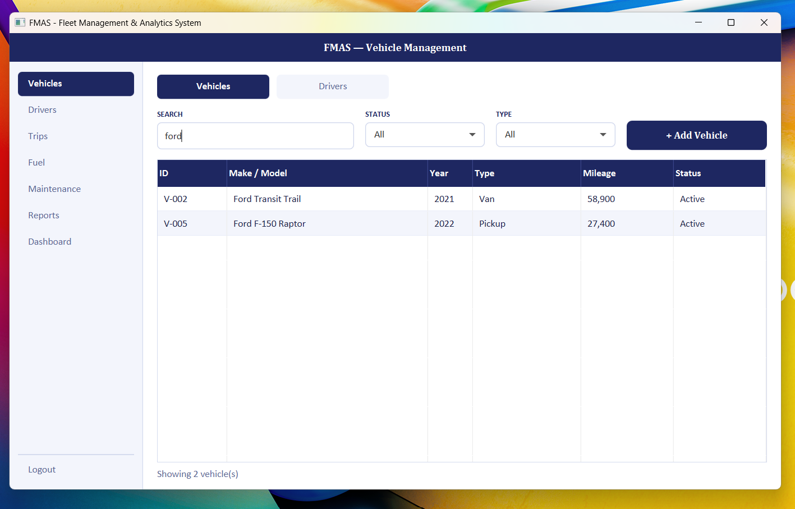
- Problems and fixes: nonethe search box did nothing because loadVehicles() still replaced the table's rows with a new list, bypassing the filtered list; fixed by loading into loadedVehicles and re-applying the search. The count text was missing a space.

### Step 6 - Add Vehicle dialog
- Commit message: Vehicles screen step 6: Add Vehicle dialog with validation (reusable MessageBar, VehicleTypes)
- What changed: + Add Vehicle opens a dialog (make/model, year, type dropdown, mileage, status dropdown); each field is checked with Validator and shows a red message when wrong; a saved vehicle appears selected in the table with a green confirmation
- Test cases touched: TC-01, TC-02
- Screenshots: 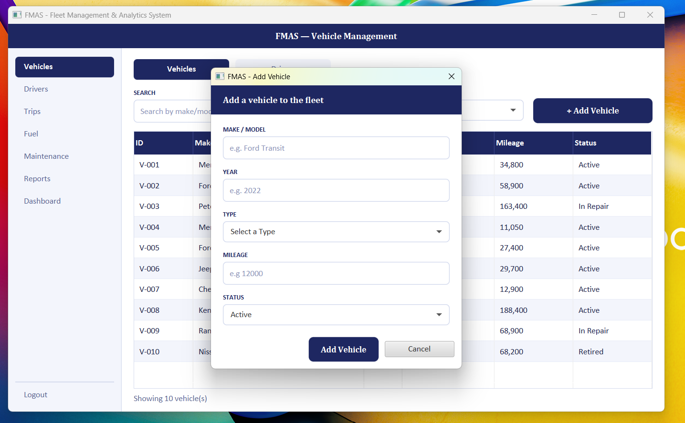 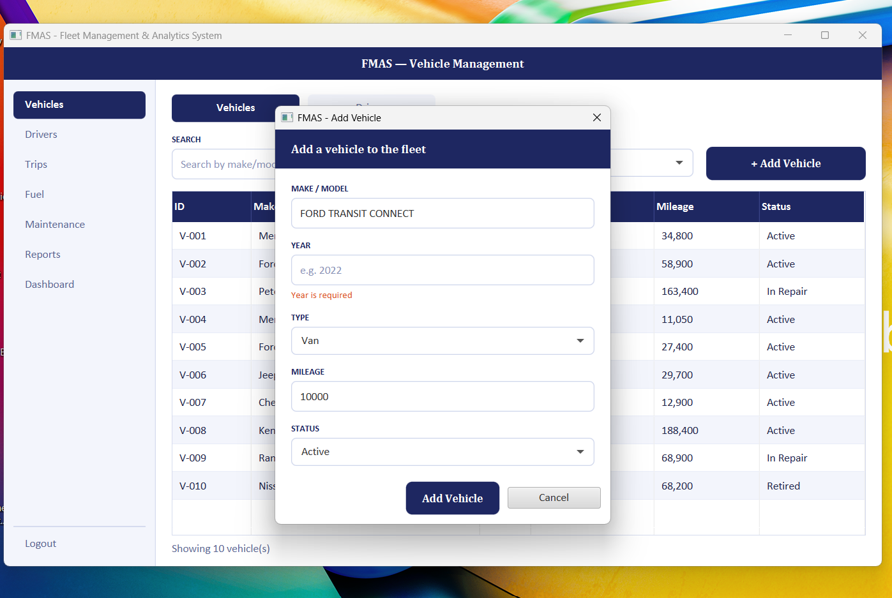 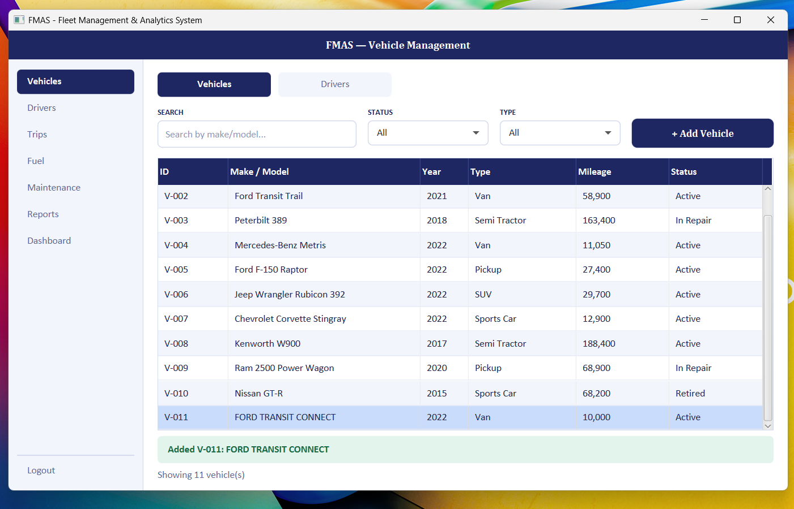
- Problems and fixes: none

### Step 7 - Update vehicle (double-click a row)
- Commit message: Vehicles screen step 7: update mileage and status by double-click (UpdateVehicleDialog, reusable FormDialog)
- What changed: the dialog shell (header, buttons, stylesheet, check before closing) moved into the reusable FormDialog; double-clicking a vehicle opens UpdateVehicleDialog to change mileage and status; mileage cannot go down (Validator.validMileage), status is chosen from a dropdown; changes are saved through VehicleDAO and the table refreshes
- Test cases touched: TC-03, TC-04, TC-05, TC-06 (TC-01 and TC-02 re-checked after the refactor)
- Screenshots: 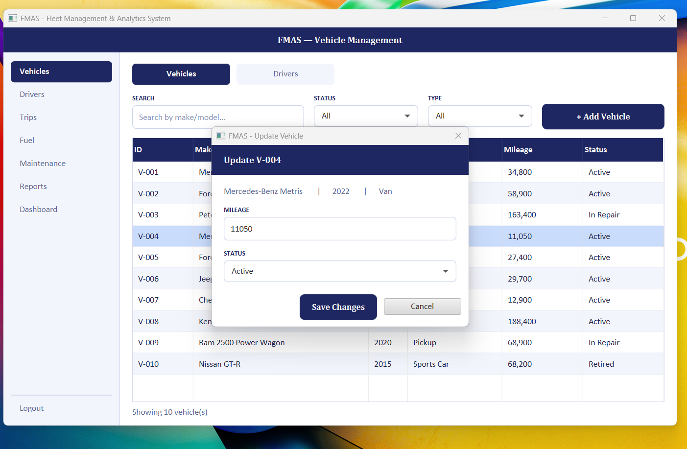 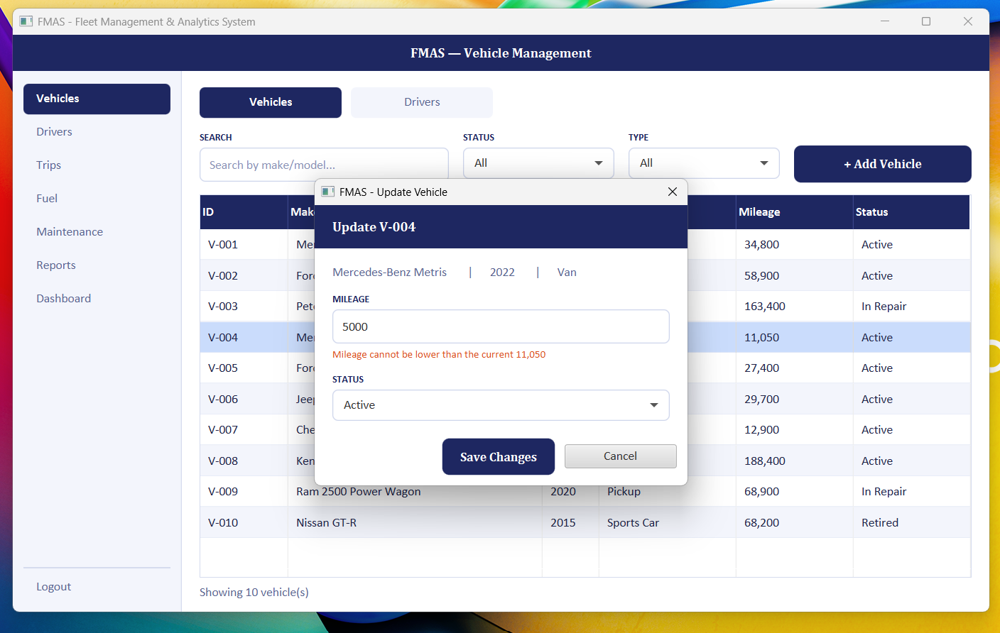 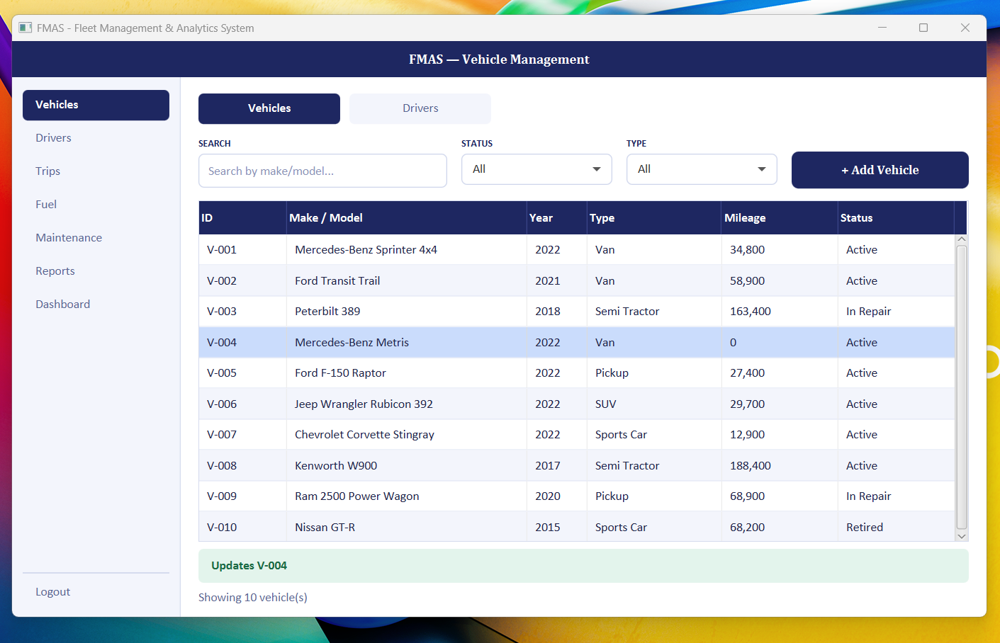
- Problems and fixes: mileage typed with a thousands separator (11,500) was rejected; both dialogs now ignore commas before reading the number

### Fix - Update dialog zeroed the mileage
- Commit message: Fix: update dialog saved mileage as 0 (newMileage was never set)
- What changed: validate() never stored the accepted mileage, so the field kept its default of 0 and every save wrote 0; it now stores the value, and the fields start from the vehicle's current values; the confirmation reads "Updated"
- Test cases touched: TC-03 and TC-05 (found while testing by hand)
- Problems and fixes: a number field that is never assigned silently stays 0, so a forgotten line caused no error

### Step 8 - Slice 1 test run
- Commit message: Slice 1 complete: TC-01 to TC-08 run and logged
- What changed: no code; all eight vehicle test cases run on sample data and passed; results written in Test_Tracking.xlsx; evidence screenshots saved in docs/evidence
- Test cases touched: TC-01 to TC-08
- Problems and fixes: none during the run (the mileage bug found earlier, TC-05, was fixed before this run)

TC-01: Vehicle saved as V-011 and shown in the list; green confirmation displayed 
TC-02: Red message “Year is required” shown; dialog stayed open; list still 11 rows
TC-03: V-004 mileage changed from 11,050 to 11,500, saved and shown in the list
TC-04: Entered 5,000 for V-004; red message “Mileage cannot be lower than the current 11,500”; table unchanged
TC-05: V-004 status changed to In Repair and mileage stayed 11,500
TC-06: Not possible by design: the Status dropdown offers only Active, In Repair and Retired, and nothing can be typed
TC-07: Only Active vehicles shown (7 of 10)
TC-08: Only Van-type vehicles shown (3)

## Login and logout (slice 2)

### Step 1 - Login back end
- Commit message: Slice 2 step 1: User, UserDAO, PasswordHasher and Authenticator (TC-27, TC-28 in the console)
- What changed: passwords are stored as salted PBKDF2 hashes (PasswordHasher); Authenticator answers whether a username and password are valid; UserDAO finds a user by username; CreateUserTool saves the first account; username is unique; no sessions yet, on the professor's advice
- Test cases touched: TC-27, TC-28 (checked in the console; the formal run is at step 4)
- Screenshot: none (the console shows the typed password)
- Problems and fixes: "pbkfd2" was misspelled inside a quoted string in verify(), which made every login fail

### Step 2 - Login card
- Commit message: Slice 2 step 2: login screen (LoginScreen) and the app starts at login
- What changed: centered login card with username, password and a LOG IN button; a failed login shows one red message; a good login opens the app; Logout in the sidebar returns to a fresh login screen
- Test cases touched: TC-27, TC-28 (checked on screen; the formal run is at step 4)
- Screenshots: 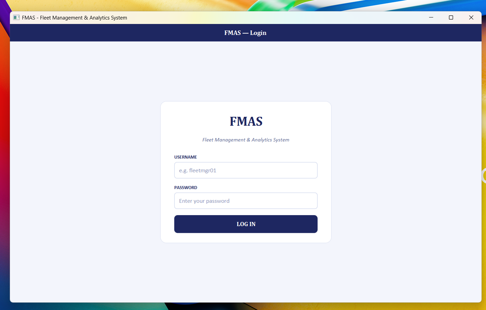 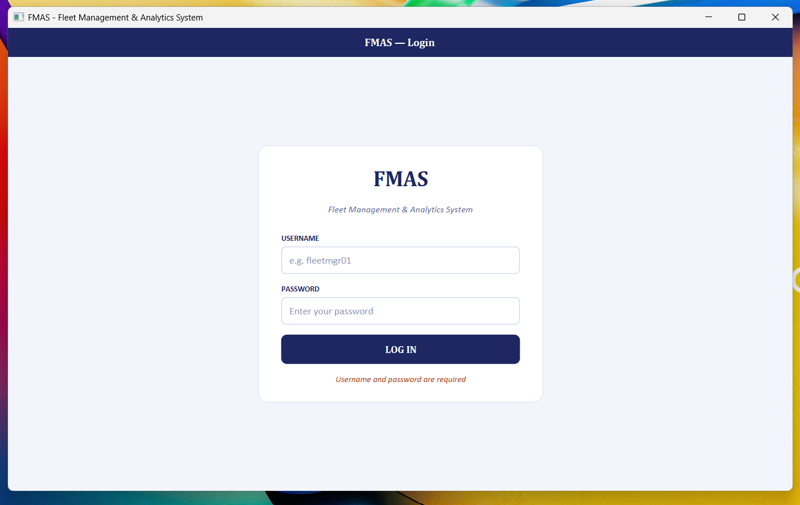
- Problems and fixes: none

### Step 3 - Main Menu shell and navigation
- Commit message: Slice 2 step 3: Main Menu shell, navigation and logout (MainMenuScreen)
- What changed: after login the Main Menu opens (welcome line, three placeholder stat cards, quick actions); Main Menu is now the first sidebar item, so every screen can return to it; Logout returns to a fresh login screen
- Test cases touched: TC-27, TC-29 (checked on screen; the formal run is at step 4)
- Screenshot: 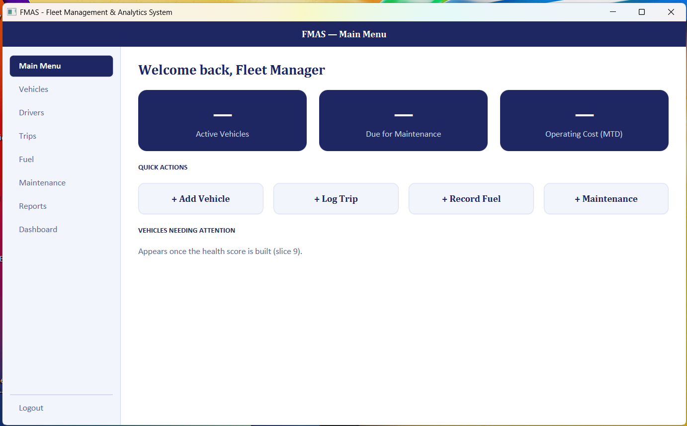
- Problems and fixes: none

### Step 4 - Slice 2 test run
- Commit message: Slice 2 complete: TC-27 to TC-29 run and logged
- What changed: no code; the three login and logout test cases run on the screen and passed; results written in Test_Tracking.xlsx; evidence screenshots saved in docs/evidence
- Test cases touched: TC-27, TC-28, TC-29
- Problems and fixes: none during the run (the earlier console failures are logged under step 1)

## Drivers (slice 3)

### Step 1 - Drivers back end
- Commit message: Slice 3 step 1: Driver, DriverStatus and DriverDAO
- What changed: Driver data class, DriverStatus (Active, Inactive) and DriverDAO (list, add, update status), checked in the console
- Test cases touched: TC-09, TC-11 (the data side; the formal run is at the end of the slice)
- Screenshot: none
- Problems and fixes: the project would not compile new enums after Eclipse lost its Java library list; fixed by registering a full Java 22 in Eclipse and rebuilding

### Step 2 - Drivers list
- Commit message: Slice 3 step 2: Drivers tab shows the driver list (DriverPane)
- What changed: the Drivers tab of the Vehicles screen lists all drivers (ID, name, license, hire date, status), sorted by last name; the tab content is its own class, DriverPane; the sidebar's Drivers item opens the screen on that tab
- Test cases touched: TC-09 (the list part; adding comes next)
- Screenshot: 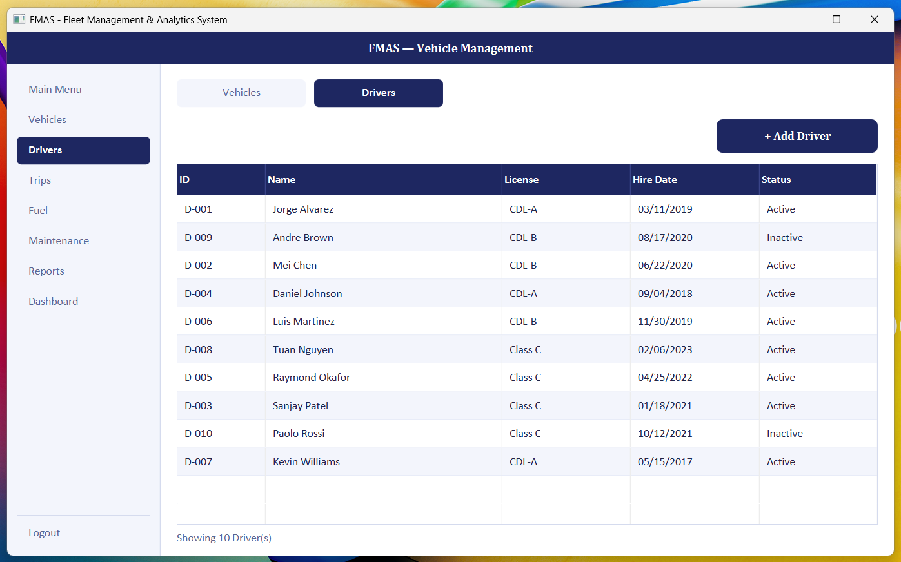
- Problems and fixes: the License column was squeezed by the wide Name column; fixed 

### Step 3 - Add Driver dialog
- Commit message: Slice 3 step 3: Add Driver dialog with date field and license type dropdown (AddDriverDialog, DateField)
- What changed: + Add Driver opens a form (first name, last name, license type dropdown, hire date); a missing or invalid field shows a red message and keeps the dialog open; a saved driver appears in the list, selected, with a green message; new reusable DateField and LicenseTypes
- Test cases touched: TC-09, TC-10 (checked on screen; the formal run is at the end of the slice)
- Screenshots: 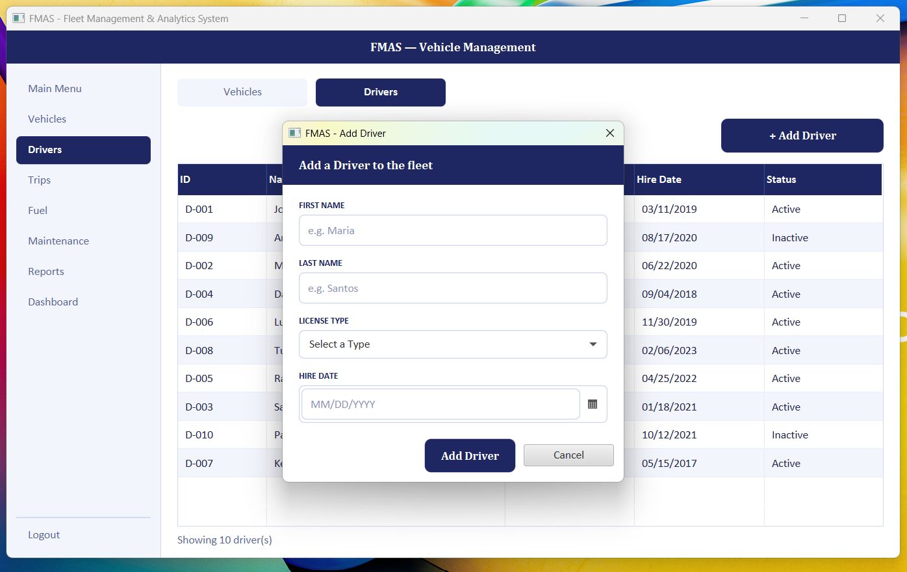 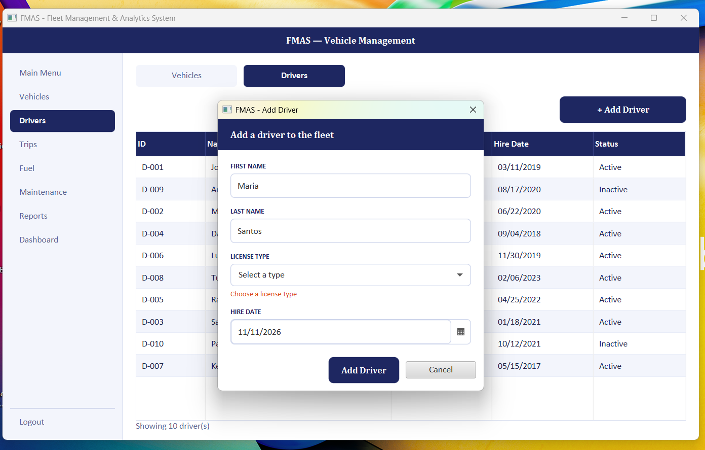
- Problems and fixes: none

### Step 4 - Change a driver's status
- Commit message: Slice 3 step 4: change a driver's status by double-click (UpdateDriverDialog)
- What changed: double-clicking a driver opens a small dialog with an Active / Inactive dropdown; a changed status is saved and shown with a green message; an unchanged status saves nothing
- Test cases touched: TC-11 (status update; the "cannot be assigned to new trips" part is proven in slice 4)
- Screenshot: 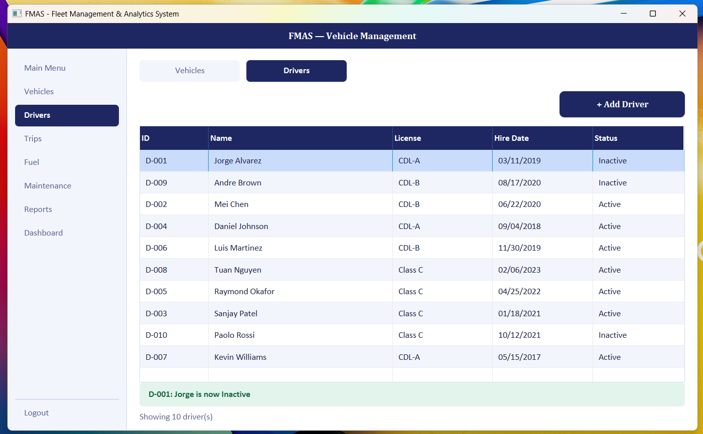
- Problems and fixes: none

### Step 5 - Slice 3 test run
- Commit message: Slice 3 complete: TC-09 to TC-11 run and logged
- What changed: no code; the three driver test cases run on the screen; results written in Test_Tracking.xlsx; evidence screenshots saved in docs/evidence
- Test cases touched: TC-09, TC-10, TC-11 (the "cannot be assigned to new trips" part of TC-11 is proven in slice 4)
- Problems and fixes: none during the run

## Trips (slice 4)

### Slice 4, Step 1 - Trip data layer
- Commit message: Add Trip class, TripDAO and active driver lookup
- What changed: Trip model, TripDAO (addTrip, findByVehicle with driver join), DriverDAO.findActive, TripDAOTest
- Test cases touched: groundwork for TC-12, TC-13, TC-14
- Problems and fixes: none

### Slice 4, Step 2 - Trips screen
- Commit message: Add Trips screen with vehicle picker and trip history
- Screenshot: 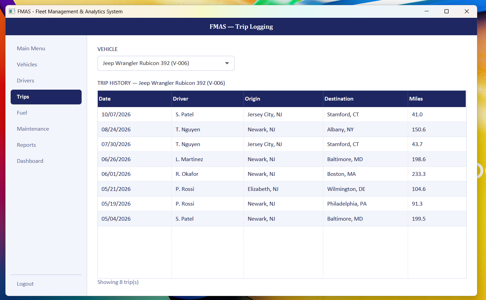
- What changed: TripScreen (vehicle dropdown, history table, count), Trips added to the sidebar navigation
- Test cases touched: groundwork for TC-14
- Problems and fixes: a missing break in the navigate switch also opened the "Coming later" dialog; added the break. Footer count was missing a space before "trip(s)"; fixed.

### Slice 4, Step 3 - New Trip form, history filters and confirmation
- Commit message: Add New Trip form, history filters and save confirmation to the Trips screen
- Screenshots: 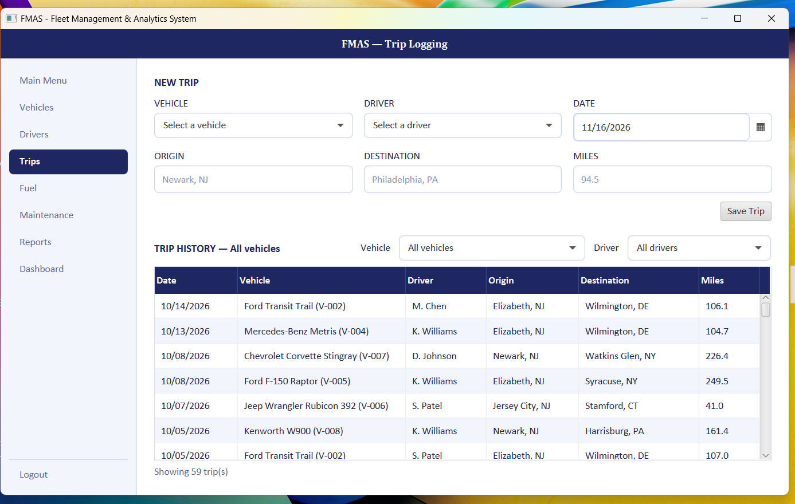 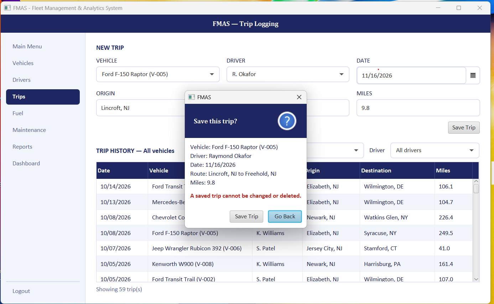
- What changed: New Trip form on TripScreen (vehicle, driver, date, origin, destination, miles, Save Trip); driver dropdown lists Active drivers only; history has a Vehicle column and separate Vehicle and Driver filters that are independent of the form; confirmation dialog warns that a saved trip cannot be changed or deleted; TripDAO.find(vehicleId, driverId) added
- Test cases touched: groundwork for TC-12, TC-13 and TC-14
- Problems and fixes: none

### Slice 4, Step 4 - Slice 4 test run
- Commit message: Slice 4 complete: TC-12 to TC-14 run and logged
- Screenshots: 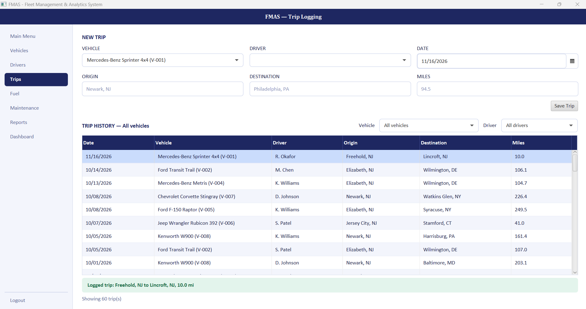 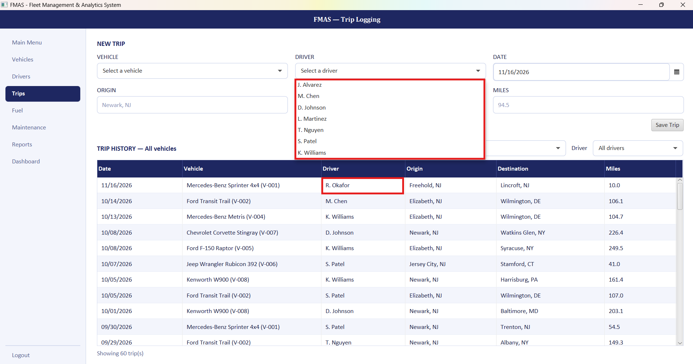 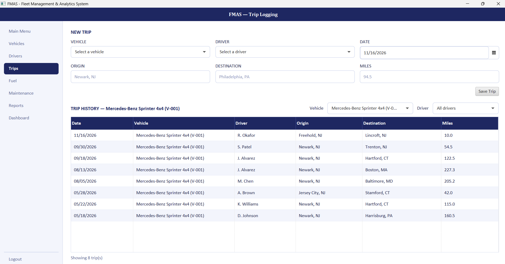
- What changed: no code; the three trip test cases run on the screen; results written in Test_Tracking.xlsx; evidence screenshots saved in docs/evidence
- Test cases touched: TC-12, TC-13, TC-14 (also completes the "cannot be assigned to new trips" half of TC-11)
- Problems and fixes: none during the run

## Fuel (slice 5)

### Slice 5, Step 1 - Fuel data layer
- Commit message: Slice 5 step 1: FuelEntry, FuelDAO and FuelDAOTest
- Screenshot: 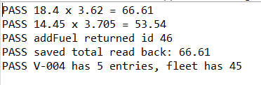
- What changed: FuelEntry model (total cost = gallons x price, rounded half-up to the cent), FuelDAO (addFuel, findByVehicle, findAll), FuelDAOTest
- Test cases touched: groundwork for TC-15 and TC-16
- Problems and fixes: none

### Slice 5, Step 2 - Fuel screen
- Commit message: Slice 5 step 2: Add Fuel screen with history table and vehicle filter
- Screenshot: 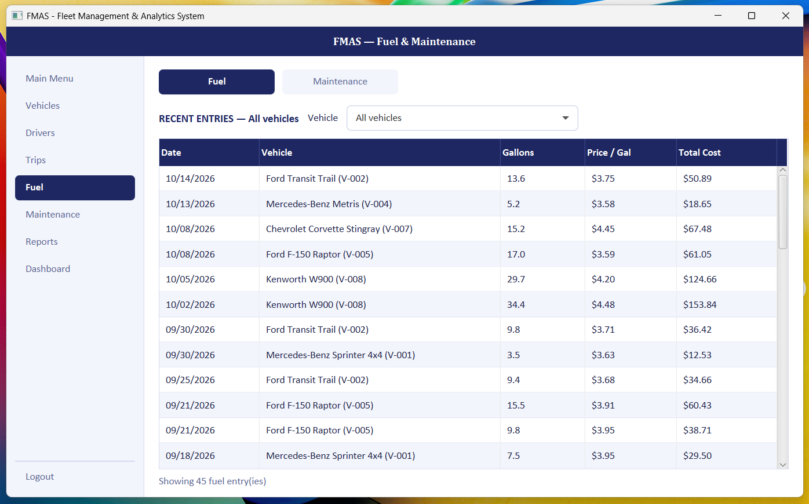
- What changed: FuelScreen with Fuel and Maintenance tabs (Maintenance is a placeholder), recent entries table (Date, Vehicle, Gallons, Price / Gal shown with 2 decimals, Total Cost), vehicle filter, count label; Fuel added to the sidebar navigation
- Test cases touched: groundwork for TC-15 and TC-16
- Problems and fixes: none

### Slice 5, Step 3 - Fuel entry form with live total
- Commit message: Slice 5 step 3: Add Fuel entry form with live total. Include Validator.java, FuelScreen.java
- Screenshot: 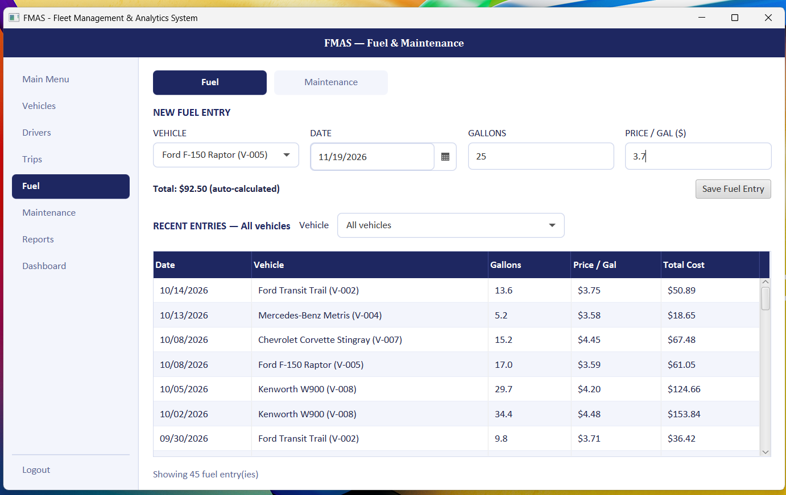
- What changed: FuelScreen split into buildForm and buildHistory; New Fuel Entry form (Active vehicles only, date that cannot pass today, gallons, price per gallon) with an auto-calculated total that updates as you type; Validator.validGallons and validCost added; Save button is not wired yet (step 4)
- Test cases touched: groundwork for TC-15 and TC-16
- Problems and fixes: the total stayed at 0.00 because the new Validator methods tested isFinite where they should have tested "not infinite", so valid numbers were rejected; fixed. Eclipse also stopped compiling the project (build path error on java.lang.Enum) and kept running old classes; fixed by pointing the project at a full JDK

### Slice 5, Step 4 - Validate and save fuel entries
- Commit message: Slice 5 step 4: Validate and save fuel entries
- Screenshots: 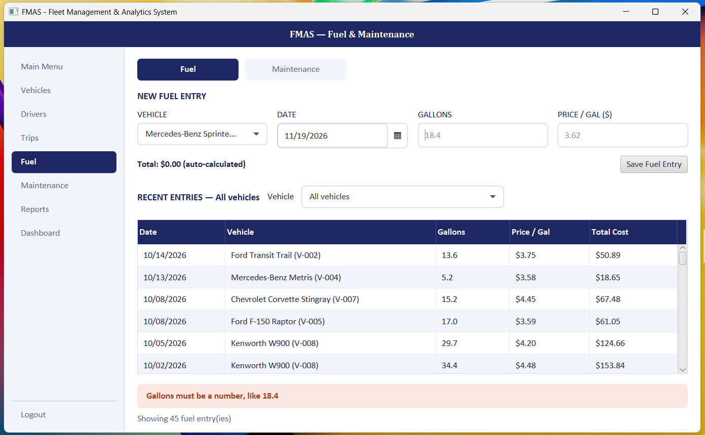 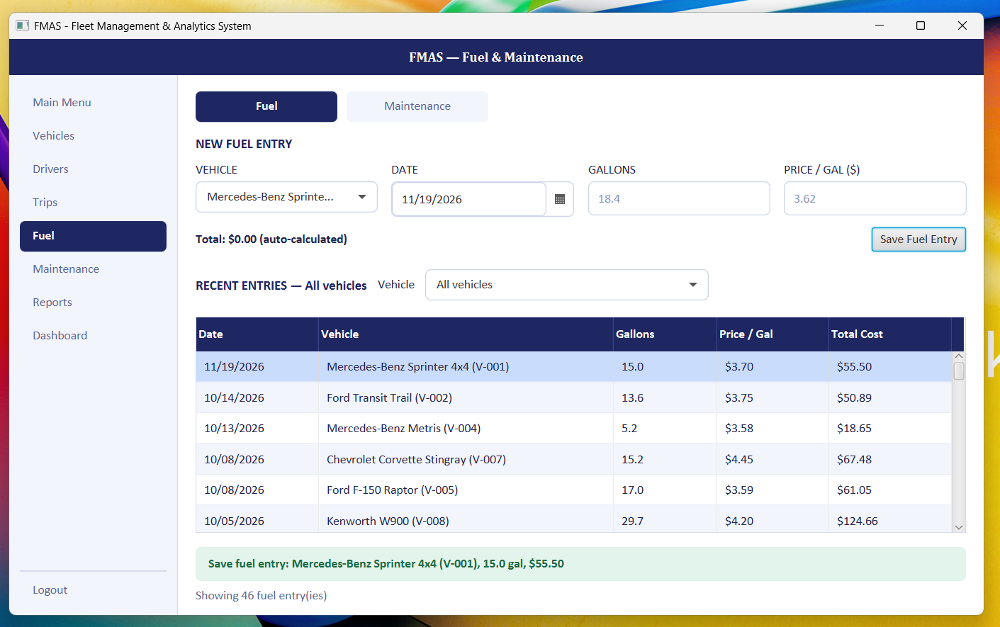
- What changed: Save Fuel Entry now checks the fields in order and shows a red message for the first problem (vehicle, date, gallons, price per gallon; gallons limited to 1 decimal and price to 2); a valid entry is saved with FuelDAO.addFuel, the history refreshes, the new row is highlighted and a green message shows the total
- Test cases touched: groundwork for TC-15 and TC-16
- Problems and fixes: none

### Slice 5, Step 5 - Save confirmation and Active vehicle check
- Commit message: Slice 5 step 5: Add save confirmation and Active vehicle check
- Screenshots: 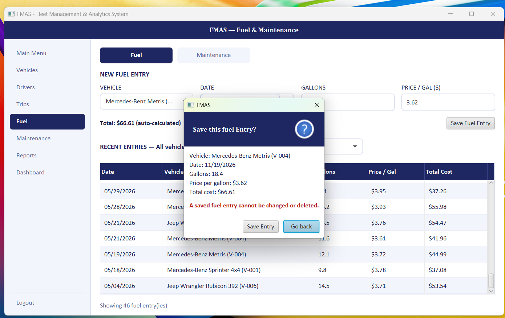 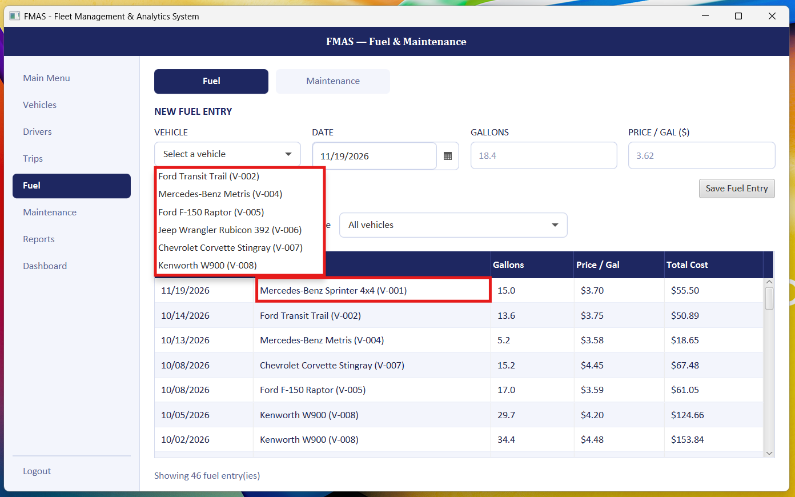
- What changed: Save Fuel Entry now shows a confirmation (vehicle, date, gallons, price per gallon, total) with a red warning that a saved fuel entry cannot be changed or deleted, and Go Back as the default button; the vehicle is re-read from the database before saving and the entry is refused if it is no longer Active; the vehicle dropdown lists Active vehicles only
- Test cases touched: groundwork for TC-15 and TC-16
- Problems and fixes: none

### Slice 5, Step 6 - Slice 5 test run
- Commit message: Slice 5 complete: TC-15 and TC-16 run and logged
- Screenshots: 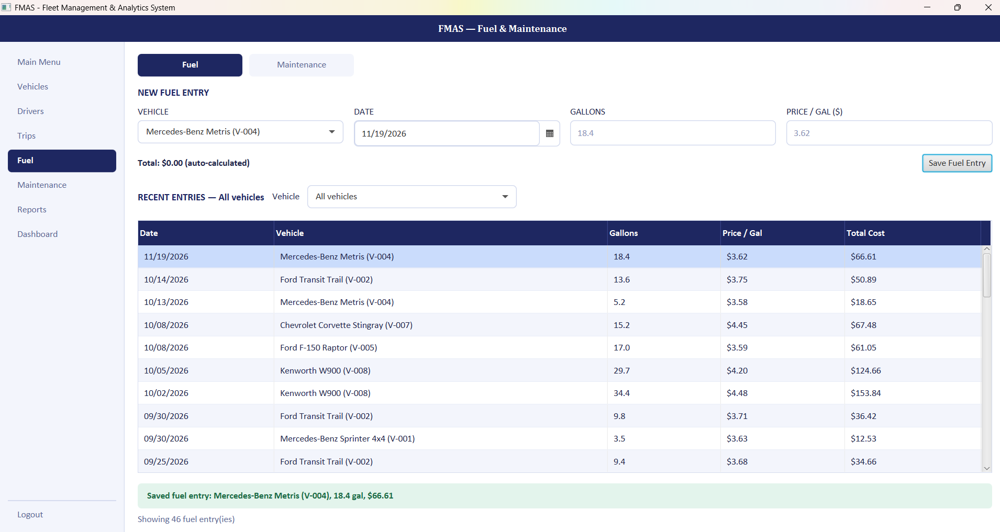 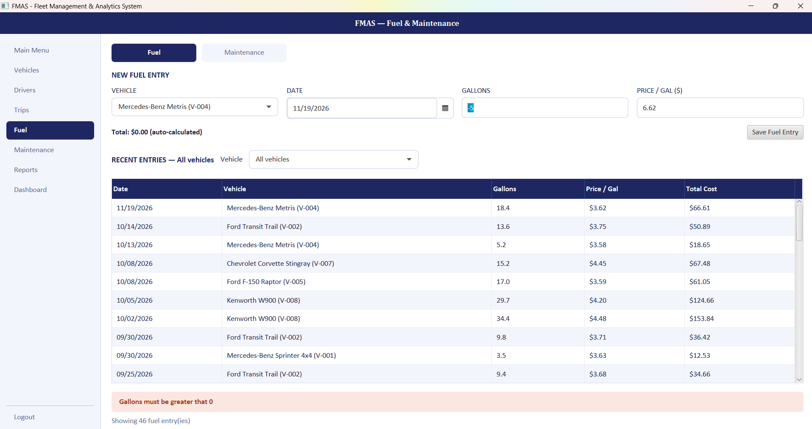
- What changed: fixed a typo in the gallons message ("that" to "than"); the two fuel test cases run on the screen; results written in Test_Tracking.xlsx; evidence screenshots saved in docs/evidence
- Test cases touched: TC-15, TC-16
- Problems and fixes: the gallons message had a typo, found while taking the evidence screenshot; fixed and the screenshot retaken

## Maintenance (slice 6)

### Slice 6, Step 1 - Maintenance data layer
- Commit message: Slice 6 step 1: MaintenanceRecord and MaintenanceDAO
- What changed: MaintenanceRecord model, MaintenanceDAO (addRecord, findByVehicle, findAll, newest first), MaintenanceDAOTest
- Test cases touched: groundwork for TC-18 and TC-19
- Problems and fixes: none

### Slice 6, Step 2 - Maintenance tab
- Commit message: Slice 6 step 2: Add Maintenance tab with history table and vehicle filter
- Screenshot: 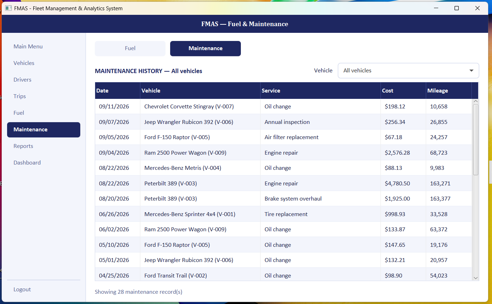
- What changed: MaintenancePane (maintenance history table with Date, Vehicle, Service, Cost and Mileage, a vehicle filter and a count) replaces the placeholder on the Maintenance tab; the Maintenance sidebar item now opens it
- Test cases touched: groundwork for TC-18 and TC-19
- Problems and fixes: none

### Slice 6, Step 3 - Maintenance form
- Commit message: Slice 6 step 3: Add maintenance form
- Screenshot: 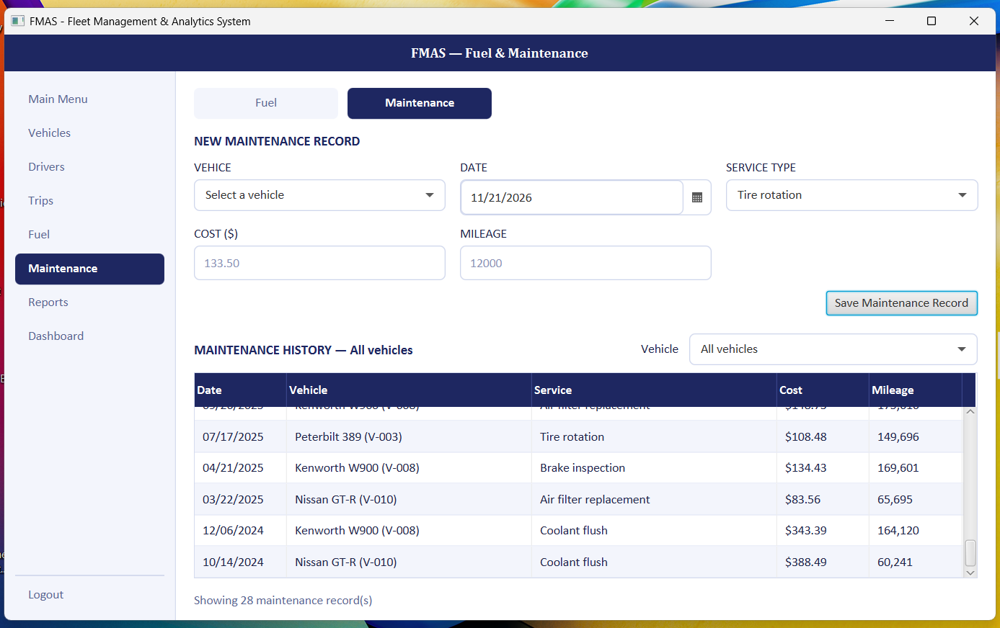
- What changed: New Maintenance Record form above the history (vehicle, date that cannot pass today, service type dropdown with an Other option, cost, mileage); the vehicle list includes every vehicle that is not Retired, so vehicles In Repair can be serviced; Save is not wired yet (step 4)
- Test cases touched: groundwork for TC-18 and TC-19
- Problems and fixes: none

### Slice 6, Step 4 - Validate and save maintenance records
- Commit message: Validate and save maintenance records
- Screenshots: 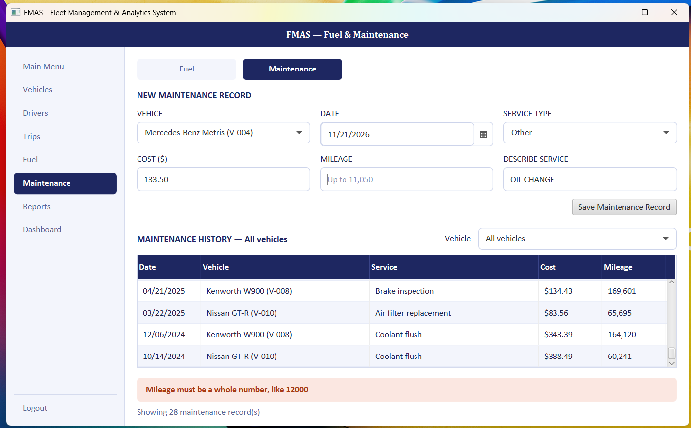 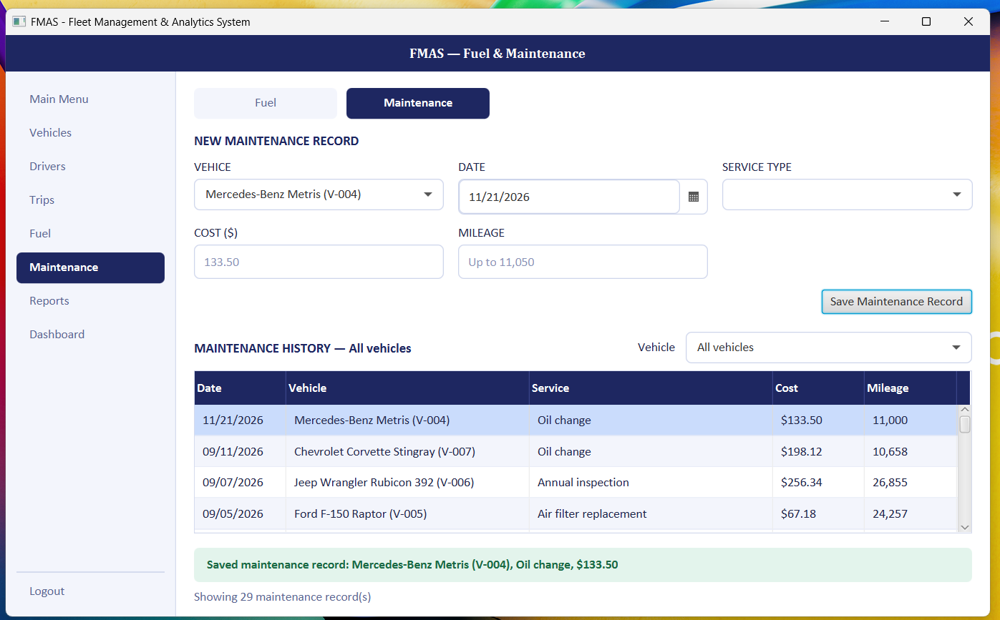
- What changed: Save Maintenance Record now checks the fields in order and shows a red message for the first problem (vehicle, date, service type, cost greater than 0 with at most 2 decimals, whole-number mileage that cannot be above the vehicle's current mileage); a valid record is saved with MaintenanceDAO.addRecord, the history refreshes, the new row is highlighted and a green message shows
- Test cases touched: groundwork for TC-18 and TC-19
- Problems and fixes: the form label VEHICLE was misspelled and the service type box lost its hint after a save; both fixed

### Slice 6, Step 5 - Save confirmation and vehicle re-check
- Commit message: Slice 6 step 5: Add save confirmation and vehicle re-check
- Screenshot: 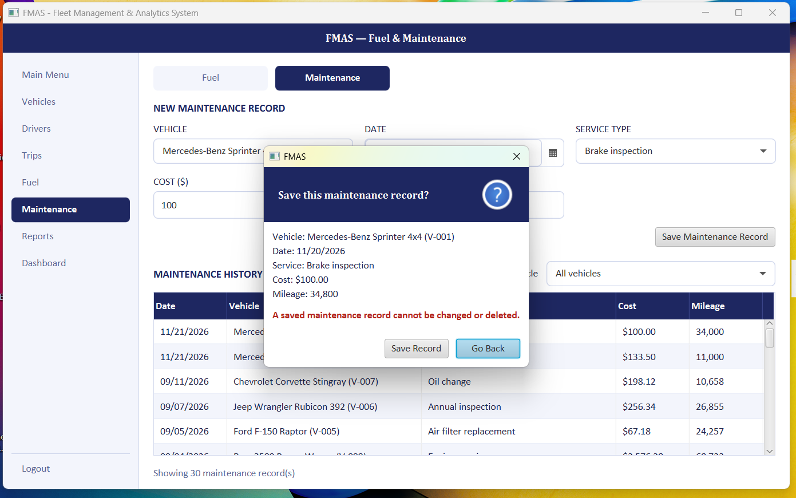
- What changed: Save Maintenance Record now shows a confirmation (vehicle, date, service, cost, mileage) with a red warning that a saved maintenance record cannot be changed or deleted, and Go Back as the default button; the vehicle is re-read from the database before saving, so a vehicle that has been retired is refused and the mileage check uses the current mileage
- Test cases touched: groundwork for TC-18 and TC-19
- Problems and fixes: none

### Slice 6, Step 6 - Slice 6 test run
- Commit message: Slice 6 complete: TC-18 and TC-19 run and logged
- Screenshots: 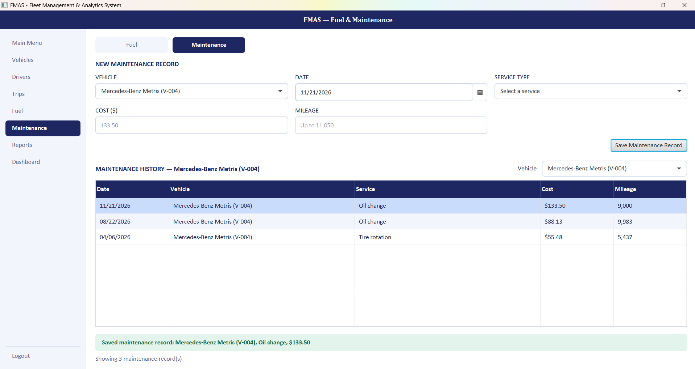 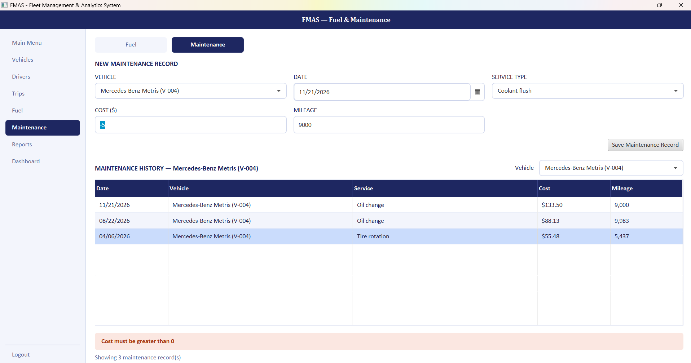
- What changed: no code; the two maintenance test cases run on the screen; results written in Test_Tracking.xlsx; evidence screenshots saved in docs/evidence
- Test cases touched: TC-18, TC-19
- Problems and fixes: none during the run

### Polish - Sidebar sync and trips update mileage
- Commit message: Polish: Sync the sidebar with the screen tabs and add trip miles to vehicle mileage
- Screenshots: 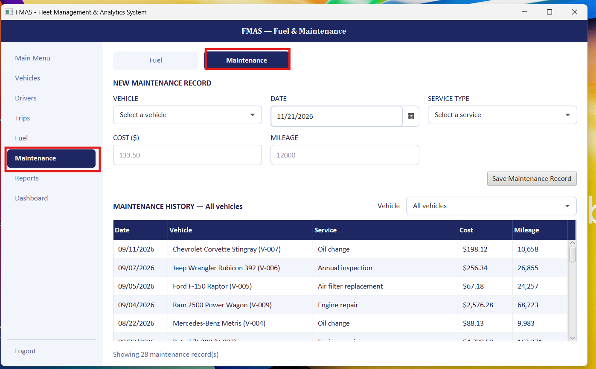 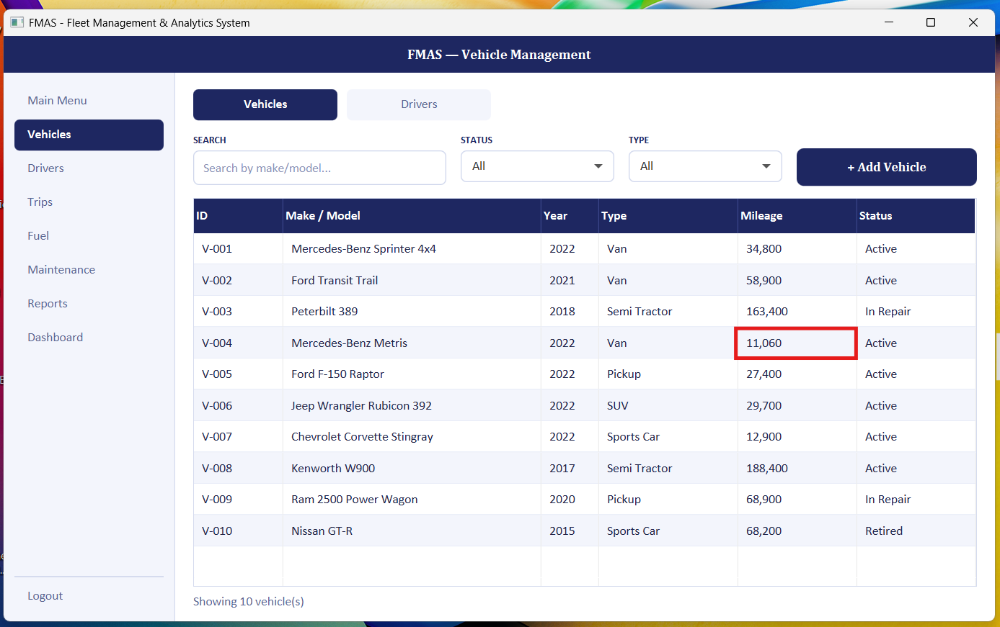
- What changed: switching between the Vehicles/Drivers tabs or the Fuel/Maintenance tabs now moves the sidebar highlight too (Sidebar select method, AppShell selectNav, a callback from MainApp to VehicleScreen and FuelScreen); TripDAO.addTrip now saves the trip and adds its rounded miles to the vehicle mileage in one transaction, so both are saved or neither is
- Test cases touched: none re-run (TC-12 to TC-14 for trips re-checked by hand: new trips still save, and the vehicle mileage goes up by the rounded miles)
- Problems and fixes: none

## Cost (slice 7)

### Slice 7 - Step 1: Operating cost query
- Commit message: Slice 7 step 1: Add the operating cost query
- What changed: CostSummary model and CostDAO.findCosts(vehicleId, from, to): one row per vehicle with fuel cost, maintenance cost and total, summed separately so rows are not double counted; CostDAOTest checks the totals against sums added up in plain Java (all vehicles, one vehicle, a date range, an empty range)
- Test cases touched: none yet (groundwork for TC-22)
- Problems and fixes: none

### Slice 7 - Step 2: Reports screen and cost report form
- Commit message: Slice 7 step 2: Add the Reports screen with the cost report form
- Screenshots: 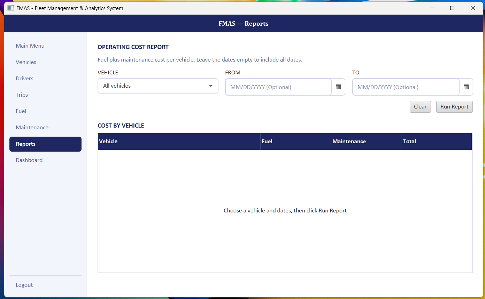
- What changed: new ReportsScreen with the operating cost report form (vehicle dropdown including Retired vehicles, optional From and To dates, Clear and Run Report buttons) and an empty results table (Vehicle, Fuel, Maintenance, Total); the Reports sidebar item now opens it from MainApp
- Test cases touched: none yet (Run Report is wired in step 3)
- Problems and fixes: none

### Slice 7 - Step 3: Run the operating cost report
- Commit message: Slice 7 step 3: Run the operating cost report
- Screenshots: 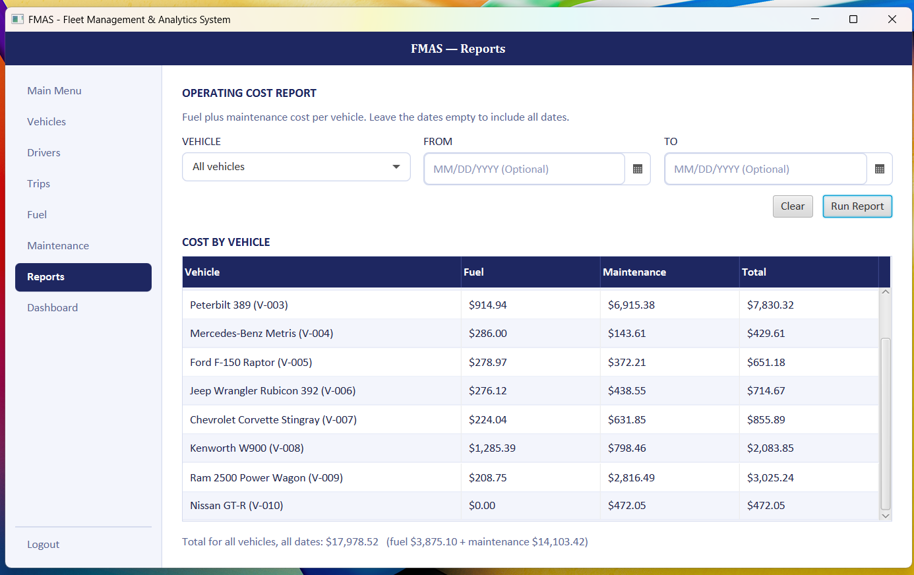 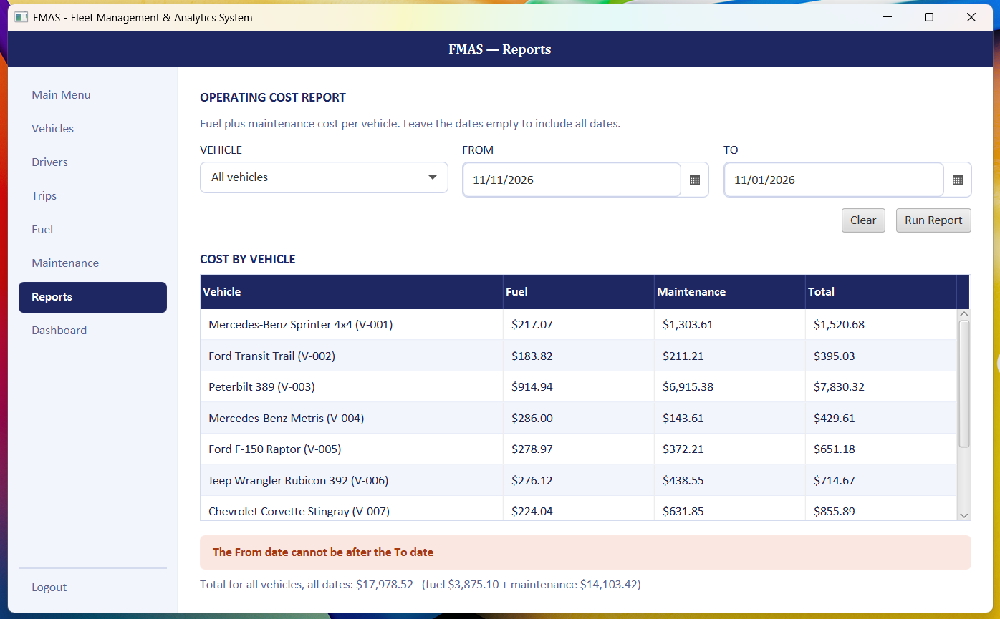
- What changed: Run Report on the Reports screen now reads CostDAO.findCosts for the chosen vehicle and dates and shows fuel, maintenance and total per vehicle, with a line under the table for the combined total and the period; date checks (valid From and To, From not after To) show a red message and put the cursor in the field; Clear also empties the results
- Test cases touched: none run yet (TC-22 is run in step 4)
- Problems and fixes: none

### Slice 7 - Step 3: Run the operating cost report
- Commit message: Slice 7 step 3: Run the operating cost report
- Screenshots:  
- What changed: Run Report on the Reports screen now reads CostDAO.findCosts for the chosen vehicle and dates and shows fuel, maintenance and total per vehicle, with a line under the table for the combined total and the period; date checks (valid From and To, From not after To) show a red message and put the cursor in the field; Clear also empties the results
- Test cases touched: none run yet (TC-22 is run in step 4)
- Problems and fixes: none

### Slice 7 - Step 4: TC-22 operating cost report
- Commit message: Slice 7 step 4: TC-22 run and logged
- Evidence: docs/evidence/TC-22.png (report in the app), docs/evidence/TC-22-sql.png (same total calculated in MySQL)
- What was tested: Reports, V-004, all dates, Run Report; the fuel, maintenance and combined total shown in the app were compared with a SQL query on the fuel and maintenance tables for vehicle 4
- Test cases touched: TC-22 passed (the report total equals fuel + maintenance in the database)
- Problems and fixes: none

### Slice 7 - Step 5: Fleet summary view for Tableau
- Commit message: Slice 7 step 5: Add the fleet summary view for Tableau
- Screenshots: 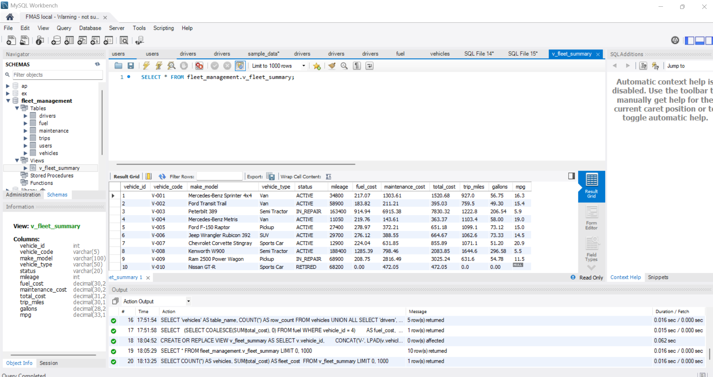
- What changed: new MySQL view v_fleet_summary (one row per vehicle: status, mileage, fuel cost, maintenance cost, total cost, trip miles, gallons, MPG) added to db/schema.sql; fuel, maintenance and trips are added up separately before joining so nothing is counted twice; Tableau will read this view in step 6; Test_Tracking.xlsx updated with the TC-22 result
- Test cases touched: TC-22 recorded as passed in the tracker (run and logged in step 4)
- Problems and fixes: none

### Slice 7 - Step 6: Activity view and demo data for the dashboard
- Commit message: Slice 7 step 6: Add the activity view and demo data for the dashboard
- Screenshots: 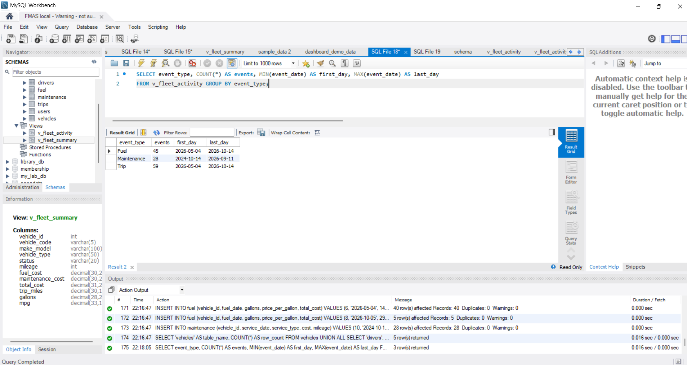
- What changed: new MySQL view v_fleet_activity (one row per fuel fill, service or trip, with vehicle details, driver and service type) added to db/schema.sql, so the dashboard can show daily, weekly and all-time views; sample_data.sql now uses Lincroft, Monmouth County routes and has two more drivers; new db/dashboard_demo_data.sql adds Sept 7 to Nov 24 activity with planted stories to detect (V-005 fuel consumption jump, V-002 double fuel week, V-008 big maintenance bills)
- Test cases touched: none (data for the dashboard; TC-26 is run later)
- Problems and fixes: the first Tableau dashboard (vehicle totals only) could not show trends, so the dashboard is rebuilt on the activity view

### Slice 7 - Step 7: Fleet dashboards in Tableau

**What changed:** Built four Tableau dashboards on the live MySQL views (v_fleet_summary and v_fleet_activity): Fleet Pulse (KPIs, spend, MPG, weekly rhythm), Leaderboard (driver podium, vehicle medals, top fuel and maintenance), Cost Control (cost vs usage, cost per mile, maintenance treemap) and Anomaly Watch (weekly MPG heatmap and alert list). The pages share a Time Window, a Top N control and vehicle filters, and navigation buttons link them. TC-26 passed: the dashboard totals match SQL run on the base tables.

**Screenshots:**
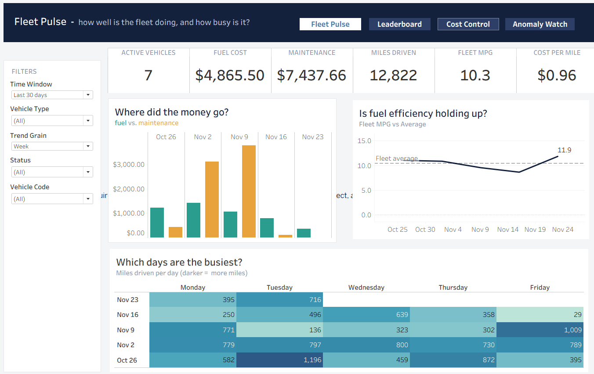
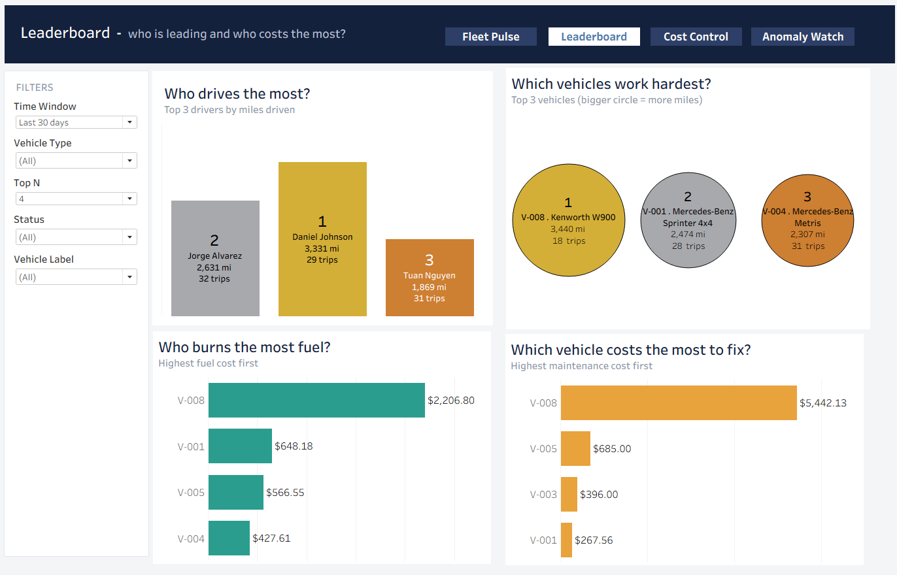

**Problems and fixes:** Tableau Public cannot connect to MySQL, so Tableau Desktop Free Edition is used. Top N is built with rank calculations, not the Top N filter. The anomaly baseline uses the previous 8 weeks, so recovery weeks are not flagged.

### Slice 8 - Step 1: Fuel efficiency (MPG) query
- Commit message: Slice 8 step 1: Add the fuel efficiency query
- What changed: MpgSummary model and MpgDAO.findMpg(vehicleId, from, to): one row per vehicle with miles (from trips) and gallons (from fuel), summed separately so rows are not double counted; MpgSummary.getMpg() divides miles by gallons and gives no value when no fuel was bought; MpgDAOTest checks miles and gallons against sums added up in plain Java (all vehicles, one vehicle, a date range, an empty range) and prints the fleet MPG
- Test cases touched: none yet (groundwork for TC-17)
- Problems and fixes: the first test run failed because 96 trips were hidden by TripDAO's join with drivers: drivers 11 and 12 were missing from the local drivers table. The two drivers were added and the test passed

### Slice 8 - Step 2: Report picker on the Reports screen
- Commit message: Slice 8 step 2: Add the report picker to the Reports screen
- Screenshots: 
- What changed: the existing operating cost report moved into its own class, CostReportPane, with no change in behavior; the new ReportsScreen shows three tiles at the top (Operating Cost, Fuel Efficiency, Maintenance Due) and swaps the report underneath when a tile is clicked; Fuel Efficiency and Maintenance Due show a short placeholder until steps 3 and 5; tile styles added to fmas.css
- Test cases touched: none (screen structure only; TC-17, TC-20 and TC-21 are run in later steps)
- Problems and fixes: none

### Slice 8 - Step 3: Fuel efficiency screen and TC-17
- Commit message: Slice 8 step 3: Add the fuel efficiency report screen and run TC-17
- Evidence: docs/evidence/TC-17.png (report in the app), docs/evidence/TC-17-sql.png (same figures calculated in MySQL), docs/evidence/TC-17-all-vehicles.png (all vehicles, all dates)
- What changed: new FuelEfficiencyPane on the Reports screen (Fuel Efficiency tile) with vehicle, From and To fields, Run Report and Clear; the table shows miles, gallons and MPG per vehicle (a dash when no fuel was bought); the line under the table shows the MPG for the whole selection, worked out as total miles divided by total gallons; date checks (valid From and To, From not after To) show a red message and put the cursor in the field; the Fuel Efficiency tile now opens this pane instead of the placeholder; Test_Tracking.xlsx updated with the TC-17 result
- What was tested: Reports, Fuel Efficiency, V-004, From 09/01/2026, To 09/30/2026, Run Report; the miles, gallons and MPG shown in the app were compared with a SQL query on the trips and fuel tables for vehicle 4 and the same dates
- Test cases touched: TC-17 passed (app: 244.8 miles, 14.8 gallons, 16.5 MPG; MySQL: 244.8 miles, 14.82 gallons, 16.5 MPG; the app shows gallons to one decimal)
- Problems and fixes: none

### Slice 8 - Cost per mile on the operating cost report
- Commit message: Slice 8: Add cost per mile to the operating cost report
- Screenshots: 
- What changed: new Cost per mile column on the Operating Cost report (total cost divided by trip miles for the same vehicle and dates, a dash when a vehicle has no trip miles); the line under the table also shows the cost per mile for the whole selection; the miles come from MpgDAO, so CostDAO is unchanged; the figure uses the same definition as the Cost Control dashboard
- What was tested: Reports, Operating Cost, All vehicles, all dates; the cost per mile of V-001, V-002, V-003, V-004 and of all vehicles was worked out by hand as Total divided by the miles shown in the Fuel Efficiency report
- Test cases touched: none (TC-22 is unchanged: fuel, maintenance and total are the same as before)
- Problems and fixes: none

### Slice 7 - Follow-up: Open the Tableau dashboard from FMAS
- Commit message: Slice 7 follow-up: Open the Tableau dashboard from FMAS
- Screenshots: 
- What changed: the Dashboard item in the sidebar now opens a Dashboard screen that lists the four dashboards and has an Open live dashboard in Tableau button; the button opens FMAS_Dashboard.twb in Tableau Desktop, which reads the fleet_management database directly, so it always shows the current data; a red message appears if the workbook file is not found; the workbook was saved in Tableau presentation mode (F7, then Ctrl+S) so it opens on Fleet Pulse with only the dashboard showing
- Test cases touched: none
- Problems and fixes: a web link is not possible: Tableau Public cannot connect to MySQL and Tableau Server or Cloud are paid, so FMAS opens the workbook in Tableau Desktop instead

### Slice 8 - Total row on the reports
- Commit message: Slice 8: Add a Total row to the cost and fuel efficiency reports
- Screenshots: 
- What changed: the Operating Cost and Fuel Efficiency tables now end with a bold Total row when more than one vehicle is listed (fuel, maintenance, total and cost per mile for the cost report; miles, gallons and MPG for the fuel report); the MPG in the Total row is total miles divided by total gallons, not the average of the rows; the columns are no longer sortable so the Total row always stays last; Total row style added to fmas.css
- What was tested: Reports, All vehicles, all dates; the Total row matches the line under each table (cost report: fuel $3,808.86, maintenance $14,053.42, total $17,862.28, cost per mile $1.88; fuel report: 9,521.7 miles, 919.6 gallons, 10.4 MPG)
- Test cases touched: none (TC-17 and TC-22 are unchanged)
- Problems and fixes: the first run showed the label V--01 and a plain row because the Total label check and the row style were not in place yet; both were added and the row now shows as Total in bold

### Slice 8 - Step 4: Maintenance-due rule and query
- Commit message: Slice 8 step 4: Add the maintenance-due rule and query
- What changed: new MaintenanceRule in the logic layer: a vehicle is due when it has gone 5,000 miles or more, or 180 days or more, since its last service; a vehicle that was never serviced is due; retired vehicles are never listed; the two limits are constants at the top of the class; new MaintenanceDueDAO.findServiceStatus() reads each vehicle's status, current mileage and last service (date and mileage from the same newest record); new models ServiceStatus and DueVehicle; MaintenanceDueTest checks the rule alone with made-up vehicles and a fixed date (4,999 and 5,000 miles, 179 and 180 days, never serviced, retired, in repair) and then checks the database result against a list worked out in plain Java through VehicleDAO and MaintenanceDAO
- Test cases touched: none yet (groundwork for TC-20 and TC-21; with the current data V-002 and V-008 are due and V-001, V-004, V-005, V-006 and V-007 are not)
- Problems and fixes: the plan does not state when a vehicle is due, so the 5,000 miles or 180 days rule is an assumption to confirm

### Slice 8 - Step 5: Maintenance due screen, TC-20 and TC-21
- Commit message: Slice 8 step 5: Add the maintenance due report and run TC-20 and TC-21
- Evidence: docs/evidence/TC-20.png (V-008 listed as due), docs/evidence/TC-21.png (V-004 not due), docs/evidence/TC-20-21-sql.png (the same figures calculated in MySQL), docs/evidence/TC-20-all-vehicles.png (full list)
- What changed: new MaintenanceDuePane on the Reports screen (Maintenance Due tile): the due list loads when the report opens, with a vehicle filter and Run Report; the table shows vehicle, last service date, miles since, days since and why it is due; a sentence under the table says how many vehicles are due, or that the chosen vehicle is not due (or is retired); the Maintenance Due tile now opens this pane instead of the placeholder; Test_Tracking.xlsx updated with the TC-20 and TC-21 results
- What was tested: Reports, Maintenance Due, All vehicles, then V-008 and then V-004 with Run Report; the miles since and days since shown in the app were compared with a SQL query on the vehicles and maintenance tables for vehicles 4 and 8
- Test cases touched: TC-20 passed (V-008: 7,741 miles and 298 days since its last service, both over the limits, listed as due); TC-21 passed (V-004: 1,067 miles and 98 days, both under the limits, not listed)
- Problems and fixes: none