# Screen build log

## Setup - JavaFX

- What was done: JavaFX 24 SDK (needs Java 22 or later) added to the project, test window opened with JavaFXTest
- Problems and fixes:
  - "JavaFX runtime components are missing": the run configuration needed the VM arguments (--module-path and --add-modules)
  - "Module javafx.controls not found": the module path was missing the colon after C, and the MySQL driver jar sat under Modulepath, which added a second module path. Fixed by moving the driver to the Classpath
  - How it was found: Process Properties > Command Line, then --list-modules outside Eclipse

## Vehicles screen

### Step 1 - Header bar
- Commit message: Vehicles screen step 1: reusable Theme and HeaderBar
- What changed: navy header bar built from the reusable Theme and HeaderBar components
- Test cases touched: none
- Screenshot: 
- Problems and fixes: none

### Step 2 - Vehicle table
- Commit message: Vehicles screen step 2: vehicle table (reusable TableColumns and Dialogs)
- What changed: table of vehicles loaded through VehicleDAO.findAll, built with the reusable TableColumns helper; errors go through the reusable Dialogs class
- Test cases touched: none
- Screenshot: 
- Problems and fixes: a leftover Test Vehicle row from the DAO test showed 11 rows instead of 10, fixed by re-running sample_data.sql; the header bar background was missing, fixed

### Step 3 - Status and type filters
- Commit message: Vehicles screen step 3: status and type filters (reusable AllChoiceBox)
- What changed: two dropdown filters built with the reusable AllChoiceBox; the table reloads through VehicleDAO.findAll(status, type); a count shows below the table
- Test cases touched: TC-07, TC-08
- Screenshots: 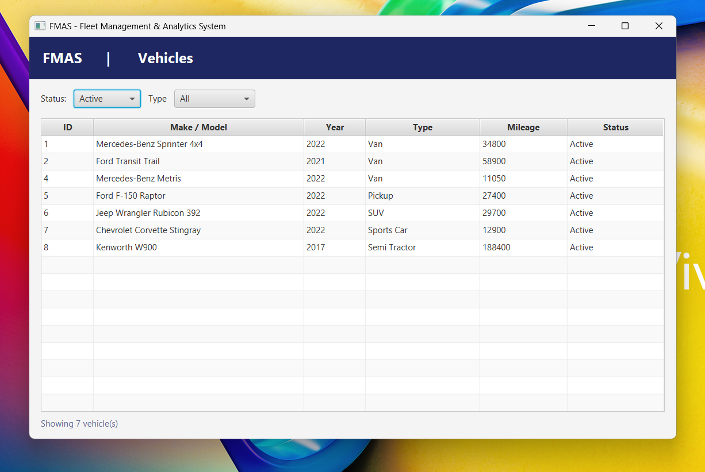 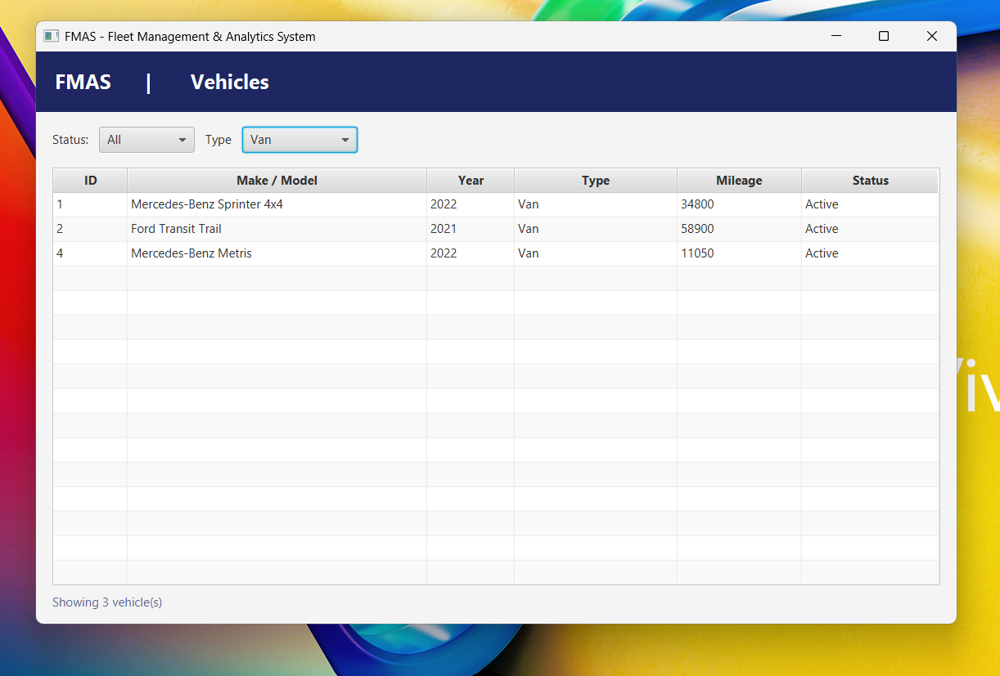
- Problems and fixes: none

### Step 4 - Shell, sidebar and tabs
- Commit message: Vehicles screen step 4: shell with sidebar, tabs and stylesheet (reusable AppShell, Sidebar, TabSwitch)
- What changed: centered navy header, sidebar with navigation and Logout, Vehicles/Drivers tabs, look moved into fmas.css; the header moved out of VehicleScreen into the shared AppShell
- Test cases touched: none
- Screenshots: 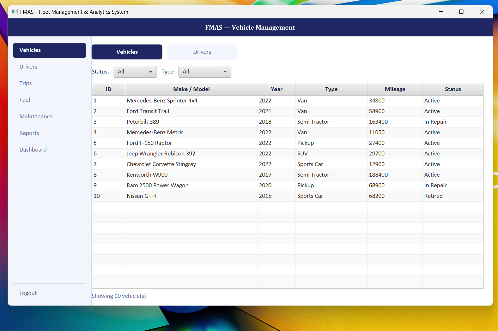 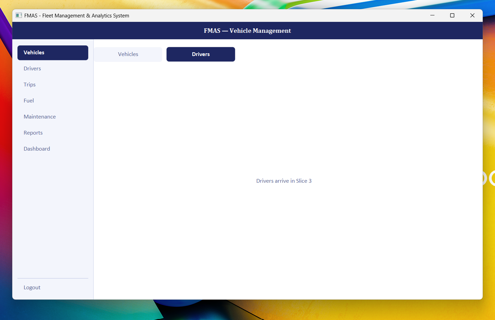
- Problems and fixed: the first run still showed the step 3 layout because MainApp opened VehicleScreen directly instead of through AppShell; the sidebar highlight first did not show, then showed on every item, fixed by making the CSS rule require both class names

### Step 5 - Filter row and styled table
- Commit message: Vehicles screen step 5: search, status and type filters, styled table (reusable LabeledField, PrimaryButton)
- What changed: SEARCH box (narrows loaded rows), STATUS and TYPE dropdowns, + Add Vehicle button, navy table header with alternating rows, IDs shown as V-001, mileage with thousands separators
- Test cases touched: TC-07, TC-08 (re-checked)
- Screenshots: 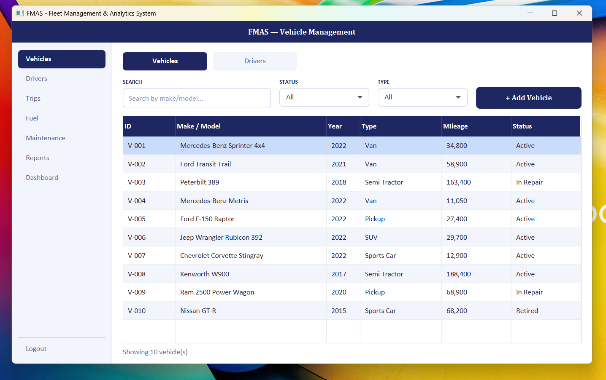 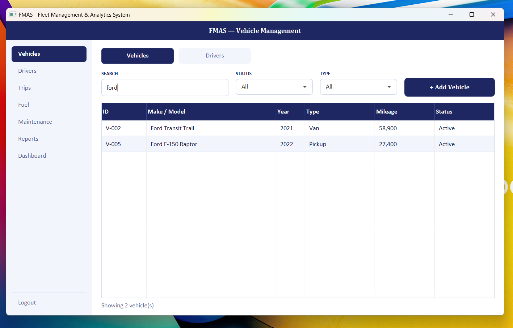
- Problems and fixes: nonethe search box did nothing because loadVehicles() still replaced the table's rows with a new list, bypassing the filtered list; fixed by loading into loadedVehicles and re-applying the search. The count text was missing a space.

### Step 6 - Add Vehicle dialog
- Commit message: Vehicles screen step 6: Add Vehicle dialog with validation (reusable MessageBar, VehicleTypes)
- What changed: + Add Vehicle opens a dialog (make/model, year, type dropdown, mileage, status dropdown); each field is checked with Validator and shows a red message when wrong; a saved vehicle appears selected in the table with a green confirmation
- Test cases touched: TC-01, TC-02
- Screenshots: 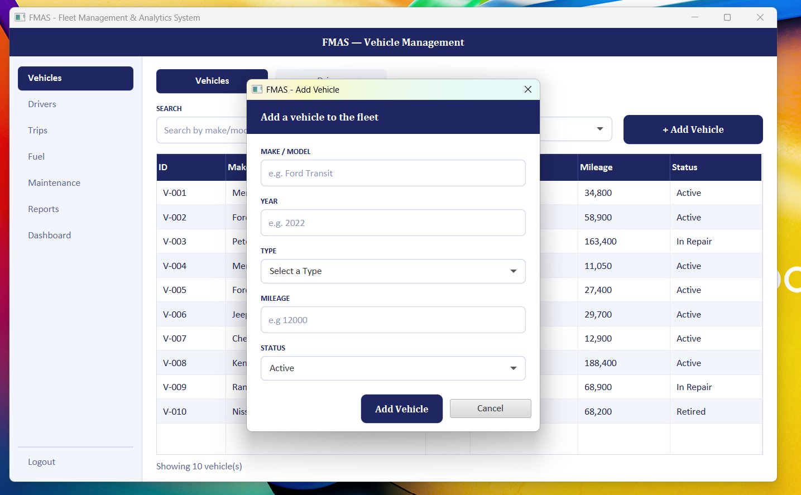 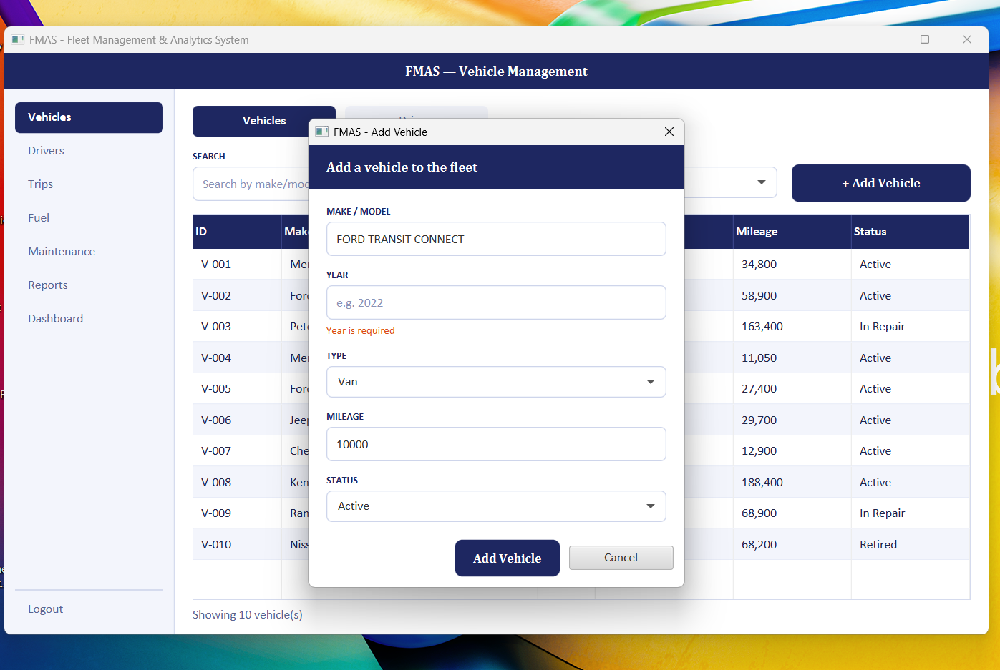 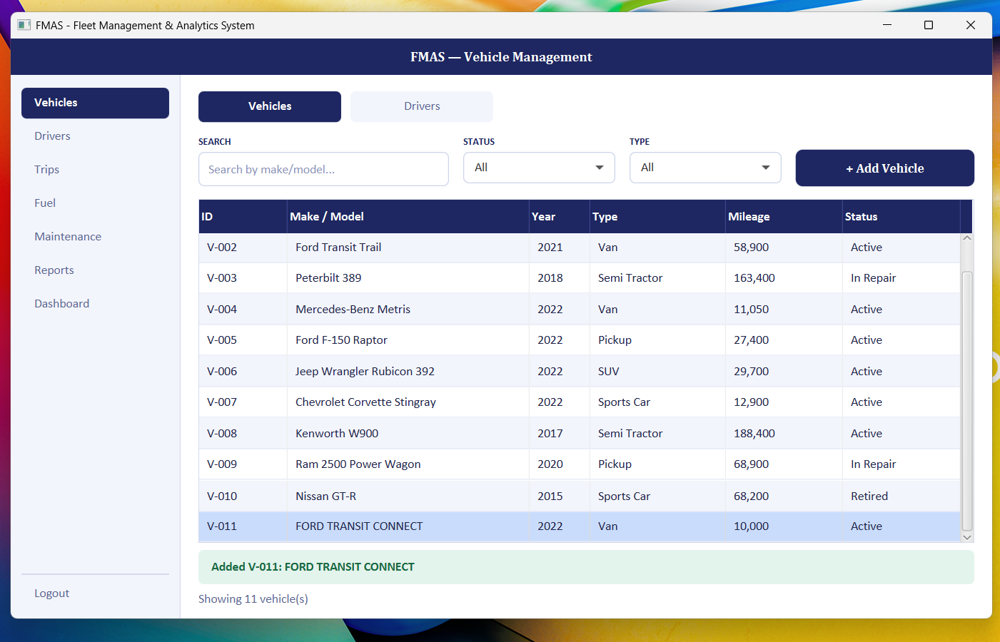
- Problems and fixes: none

### Step 7 - Update vehicle (double-click a row)
- Commit message: Vehicles screen step 7: update mileage and status by double-click (UpdateVehicleDialog, reusable FormDialog)
- What changed: the dialog shell (header, buttons, stylesheet, check before closing) moved into the reusable FormDialog; double-clicking a vehicle opens UpdateVehicleDialog to change mileage and status; mileage cannot go down (Validator.validMileage), status is chosen from a dropdown; changes are saved through VehicleDAO and the table refreshes
- Test cases touched: TC-03, TC-04, TC-05, TC-06 (TC-01 and TC-02 re-checked after the refactor)
- Screenshots: 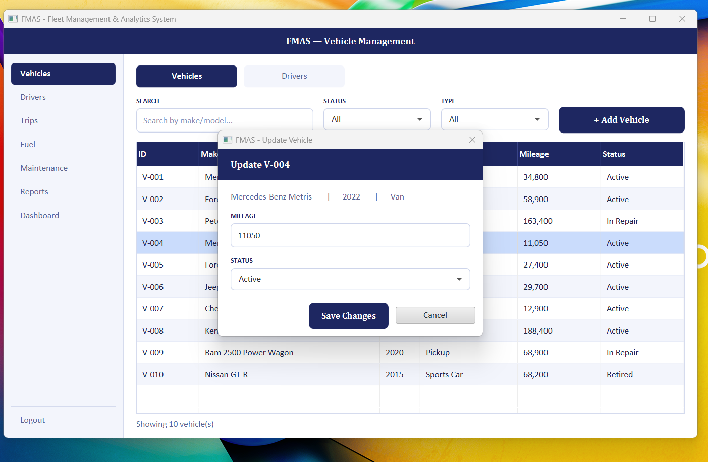 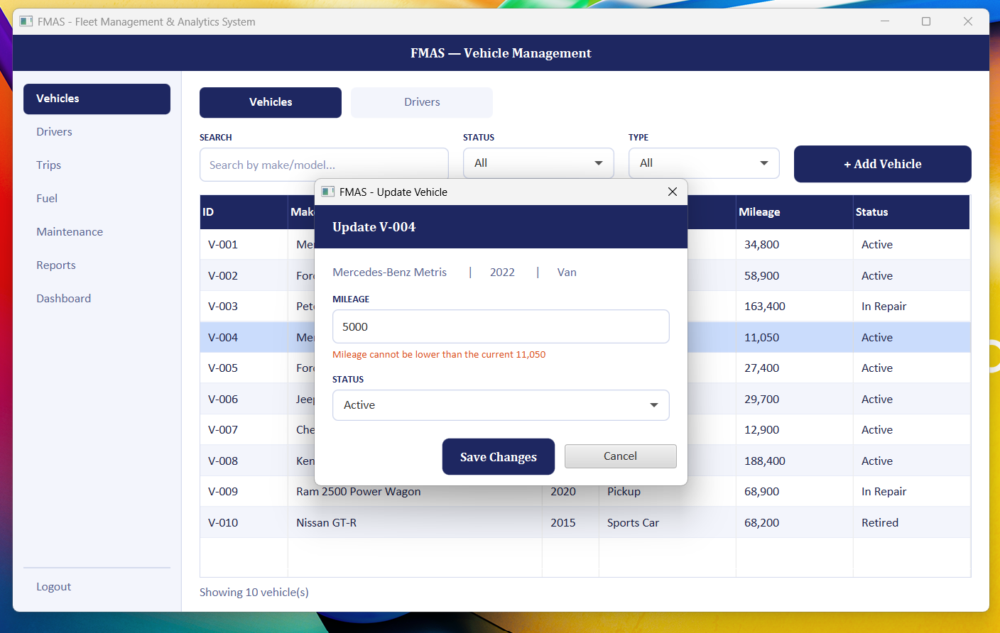 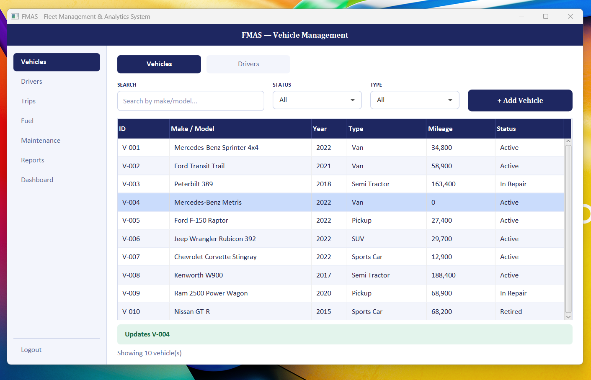
- Problems and fixes: mileage typed with a thousands separator (11,500) was rejected; both dialogs now ignore commas before reading the number

